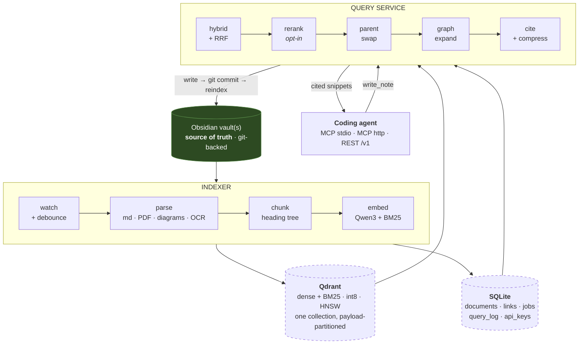

<div align="center">

# VaultRAG

**A self-hosted, MCP-first RAG backend that coding agents query instead of loading docs
into context — and can write back into.**

[](https://pypi.org/project/vaultrag/)
[](https://pypi.org/project/vaultrag/)
[](LICENSE)

[Getting started](docs/getting-started.md) ·
[Architecture](docs/architecture.md) ·
[CLI](docs/cli-reference.md) ·
[MCP tools](docs/mcp-tools.md) ·
[Benchmarks](docs/benchmarks.md) ·
[All docs](docs/README.md)

</div>

---

Point it at an Obsidian vault. It indexes your Markdown — plus PDFs, Mermaid, Excalidraw
and OCR'd images — and serves **cited snippets** over MCP and REST. Your agent searches
instead of reading files, and can persist what it learns as new notes that are
git-committed and searchable in the same session.

Everything runs locally. No API key is required for anything.

**Install:** `pip install vaultrag` or `uvx vaultrag` — it's [published on PyPI](https://pypi.org/project/vaultrag/).
The quickstart below runs from a clone, which also gives you the `docker-compose.yml` for Qdrant and the observability stack:

```bash
uv sync
docker compose up -d qdrant
ollama pull qwen3-embedding:0.6b
uv run vaultrag project add mynotes --vault ~/Documents/MyVault
uv run vaultrag reindex --project mynotes
claude mcp add vaultrag -- uv run --directory "$PWD" vaultrag mcp
```

That's it — [step-by-step version here](docs/getting-started.md).

---

## Why

An agent that loads your docs into context burns tokens on everything it might need. An
agent that searches loads only what it does need — and gets a citation it can follow.

VaultRAG is built around four opinions:

- **The vault is the source of truth.** Every index, vector and graph edge is a disposable
  cache. Disaster recovery is one `reindex`, and your knowledge stays as Markdown files in a
  folder you own.
- **Return snippets, not answers.** The caller is already an LLM. Synthesizing server-side
  burns compute to lose information.
- **Hybrid always.** Dev notes are full of `ERR_CONN_RESET` and `MER-1422`. Dense-only
  retrieval misses exact matches; BM25-only misses paraphrases. You need both.
- **Quality is measured, not asserted.** A merge-blocking eval gate scores retrieval on
  every PR. Numbers on this page come from runs that were executed, not estimated.

---

## Architecture



The dashed stores are the point: delete both, `reindex`, and the system is fully rebuilt
from bare Markdown. [Full system design →](docs/architecture.md)

---

## What it does

| | |
|---|---|
| **Hybrid retrieval** | BM25 + dense vectors, fused with RRF in one Qdrant round-trip. Exact identifiers rank as well as paraphrases. |
| **Structure-aware chunking** | Heading-tree, not sliding windows. Every snippet cites `path ▸ H1 ▸ H2 ▸ lines` and carries a clickable `obsidian://` link. |
| **Parent-child context** | Small chunks rank precisely; retrieval returns the whole enclosing section, reconstructed live from the vault. |
| **The vault's own graph** | Wikilinks become a retrieval signal (authority) and an exploration tool (`related`). Zero LLM calls, sub-millisecond. |
| **Optional cross-encoder** | bge-reranker-v2-m3 as `never` / `auto` / `always` — `auto` decides per query from retriever agreement, costing nothing to decide. |
| **Token budgets** | Every response respects `budget_tokens`. Near-dupe drop → MMR → per-doc cap → trim. Deterministic and free. |
| **Write-back = agent memory** | `write_note` / `append_section` / `patch_frontmatter`, git-committed and reindexed synchronously — searchable in the same session. |
| **Multi-project tenancy** | One deployment, many vaults. Server-side enforcement; a client filter can narrow, never widen. Verified adversarially. |
| **Full-format ingestion** | Markdown, PDF (Docling), Mermaid, Excalidraw, OCR'd images, frontmatter, callouts, dataview fields. |
| **Live indexing** | watchdog + debounce + content-hash manifest. Renames re-embed nothing. |
| **Secrets never indexed** | Non-overridable filename deny list + a two-tier content scan, enforced in code at scan *and* parse time. |
| **Production posture** | Scoped argon2 API keys, rate limits, Prometheus metrics, provisioned Grafana dashboard, five alert rules. |

---

## Measured

| | |
|---|---|
| Retrieval gate (72 cases, frozen corpus) | **recall@10 1.000 · MRR@5 0.892 · nDCG@10 0.920** |
| With `auto` rerank | MRR@5 **0.946** |
| Memory at 100k chunks | **≈1.8 GB** total (727 MiB containers + host Ollama) |
| Cold index, CPU only | 67 docs → 261 chunks in **326 s** |
| Warm reindex, no changes | **95–139 ms** |
| Graph expand · compression | p50 **0.39 ms** · **1.5 ms** |
| Tests | **923**, plus `mypy --strict` and a merge-blocking quality gate |

[Methodology, the full record, and the known gaps →](docs/benchmarks.md)

---

## Documentation

| | |
|---|---|
| [**Getting started**](docs/getting-started.md) | Install → vault → index → Claude Code. Step by step. |
| [**CLI reference**](docs/cli-reference.md) | Every command and flag. |
| [**MCP tools**](docs/mcp-tools.md) | What your agent sees: `search`, `open`, `related`, `overview`, write tools. |
| [**REST API**](docs/rest-api.md) | `/v1` endpoints, bodies, status codes. |
| [**Configuration**](docs/configuration.md) | Every setting and why its default is what it is. |
| [**Architecture**](docs/architecture.md) | System design and diagrams. |
| [**Indexing pipeline**](docs/indexing.md) | The write path. |
| [**Retrieval pipeline**](docs/retrieval.md) | The read path, stage by stage. |
| [**Design decisions**](docs/design-decisions.md) | Techniques, alternatives, and evidence. |
| [**Benchmarks**](docs/benchmarks.md) | Measured quality, latency, memory. |
| [**Security model**](docs/security.md) | Tenancy, secrets, keys, write-back safety. |
| [**Operations**](docs/operations.md) | Docker, metrics, alerts, backup, runbook. |
| [**Troubleshooting**](docs/troubleshooting.md) | Symptom → cause → fix. |
| [**Development**](docs/development.md) | Tests, the eval gate, CI, conventions. |
| [**Resources**](docs/resources.md) | Every external link, and the map to the design vault. |

---

## Stack

| Layer | Choice |
|---|---|
| Vector + keyword | Qdrant — one collection, named vectors `dense` + `bm25`, int8, payload-partitioned |
| Dense embeddings | Qwen3-Embedding-0.6B via Ollama (1024d, Matryoshka-truncatable) |
| Sparse | BM25 via FastEmbed → Qdrant sparse vectors |
| Reranker | bge-reranker-v2-m3, ONNX int8, opt-in |
| Metadata + graph | SQLite (WAL) → Postgres 16; wikilink graph = `links` table + recursive CTEs |
| Parsing | markdown-it-py + python-frontmatter + custom Obsidian rules; Docling for PDFs |
| Jobs | In-process asyncio + a SQLite `jobs` table |
| API / MCP | FastAPI + FastMCP — one image serves REST and MCP (stdio & http) |
| Deploy | Docker Compose, one box |

Every vendor sits behind a protocol (`Embedder`, `Reranker`, `VectorStore`, `MetaStore`), so
a paid API is a config change, never a code change.
[Why each was chosen →](docs/design-decisions.md)

---

## Deployment

One image, two roles (`VAULTRAG_ROLE=api|indexer`), three services.

```bash
ollama pull qwen3-embedding:0.6b                    # Ollama stays on the HOST (GPU)
docker compose run --rm api project add mydocs --vault /vaults/my-notes
docker compose run --rm api reindex --project mydocs
docker compose up -d --build
docker compose logs api | grep -i "api key"         # bootstrap key, printed once
```

```bash
curl -H "Authorization: Bearer $VAULTRAG_KEY" \
  -H 'Content-Type: application/json' -d '{"query":"how does chunking work","k":5}' \
  http://127.0.0.1:8000/v1/mydocs/search
```

Optional observability profile:

```bash
docker compose --profile observability up -d
open http://127.0.0.1:3000     # Grafana — dashboard provisioned
```

The API publishes on `127.0.0.1` only; remote access is Tailscale/WireGuard, not an open
port. **The vault's git remote is the backup** — the volumes hold a derived cache.
[Full deployment guide →](docs/operations.md)

---

## Development

```bash
uv sync                                          # install
uv sync --extra pdf                              # + Docling/OCR (heavy: torch)
uv run pytest                                    # 923 tests
uv run vaultrag eval                             # the retrieval-quality gate
uv run ruff check src tests && uv run ruff format --check src tests && uv run mypy src
```

Any change to chunking parameters, the embedding model, fusion weights or rerank config
must run the eval harness. Regressions block merge — that is what makes model swaps safe
instead of vibes. [Contributing guide →](docs/development.md)

---

## Project state

**P3 — production posture.** Stages 1–6 shipped: deterministic stage-7 compression, the
multi-project registry, the query log and its mining CLI, the REST `/v1` transport, scoped
API keys, and the Docker deployment. First release — [`vaultrag 0.1.0`](https://pypi.org/project/vaultrag/) — is on PyPI.

See [`MEMORY.md`](MEMORY.md) for exactly where things are, and [`CLAUDE.md`](CLAUDE.md) if
you are an agent working in this repo.

The design and knowledge for this system live in an Obsidian vault at `../Rag` — that vault
decides *what to build and why*, this repo executes it, and the running index is a
disposable cache derived from the vault.

---

<div align="center">

MIT · built with [Claude Code](https://claude.com/claude-code)

</div>
