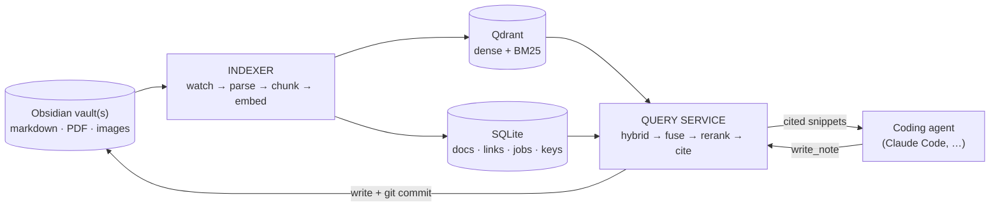

# VaultRAG documentation

Self-hosted, MCP-first RAG backend over Obsidian vaults. Coding agents **query** it
instead of loading docs into context, and **write back** into it so what they learn
survives the session.

This directory is the complete documentation set. Start wherever your question is.

---

## Read this first

| If you want to… | Go to |
|---|---|
| **Get it running in 15 minutes** | [Getting started](getting-started.md) |
| **Connect it to Claude Code / an MCP agent** | [Getting started §6](getting-started.md#6-connect-it-to-claude-code) → [MCP tools](mcp-tools.md) |
| **Look up a command** | [CLI reference](cli-reference.md) |
| **Understand how it works** | [Architecture](architecture.md) |
| **Understand *why* it works that way** | [Design decisions](design-decisions.md) |
| **See the numbers** | [Benchmarks](benchmarks.md) |
| **Deploy it on a box** | [Operations](operations.md) |
| **Fix something broken** | [Troubleshooting](troubleshooting.md) |

---

## The full set

### Using it

| Document | What's in it |
|---|---|
| [**Getting started**](getting-started.md) | Prerequisites → install → register a vault → index → connect Claude Code. Step by step, nothing assumed. |
| [**CLI reference**](cli-reference.md) | Every command and every flag: `reindex`, `watch`, `mcp`, `serve`, `project`, `key`, `queries`, `eval`. |
| [**MCP tools**](mcp-tools.md) | The agent-facing surface: `search`, `open`, `related`, `overview`, `list_projects`, `write_note`, `append_section`, `patch_frontmatter`. Signatures, response shapes, usage patterns. |
| [**REST API**](rest-api.md) | `/v1` over HTTP — the same core behind a different transport. Endpoints, bodies, status codes, errors. |
| [**Configuration**](configuration.md) | Every `VAULTRAG_*` setting, its default, and why the default is what it is. |

### Understanding it

| Document | What's in it |
|---|---|
| [**Architecture**](architecture.md) | The system in diagrams: three deployable units, one image, one codebase. Components, data flow, storage layout, tenancy. |
| [**Indexing pipeline**](indexing.md) | The write path: scan → parse → chunk → embed → upsert. Idempotency, renames, partial-failure safety, live watch. |
| [**Retrieval pipeline**](retrieval.md) | The read path: 9 stages from query to cited snippet, each with what it does, what it costs, and when it's worth it. |
| [**Design decisions**](design-decisions.md) | Every significant technique choice, the alternative it beat, and the evidence. Includes what was deliberately rejected. |
| [**Benchmarks**](benchmarks.md) | Measured quality, latency, throughput, and memory. Methodology first, numbers second. |

### Running it

| Document | What's in it |
|---|---|
| [**Operations**](operations.md) | Docker deployment, compose profiles, metrics, dashboards, alert rules, backup and disaster recovery. |
| [**Security model**](security.md) | Tenancy enforcement, the secret guard, API keys and scopes, write-back safety, prompt-injection posture. |
| [**Troubleshooting**](troubleshooting.md) | Symptom → cause → fix, for the failures that actually happen. |
| [**Development**](development.md) | Repo layout, test suite, the merge-blocking eval gate, CI, and how to contribute a change safely. |
| [**Resources**](resources.md) | Every external link that matters, plus the map from this repo to the design vault. |

---

## The one-paragraph version

An **indexer** watches one or more Obsidian vaults, parses Markdown (plus PDFs, Mermaid,
Excalidraw and OCR'd images), splits notes along their heading tree, embeds each chunk
with a local Qwen3 model, and upserts into a single Qdrant collection carrying both dense
and BM25-sparse vectors. A **query service** takes a natural-language question or a bare
error string, runs both retrievers, fuses them with RRF, optionally reranks with a
cross-encoder, swaps matched fragments for their enclosing sections, reorders by the
vault's own wikilink authority, compresses to a token budget, and returns **cited
snippets — not answers**, because the caller is already an LLM. Agents reach it over
**MCP** (stdio or HTTP) or **REST**, and can write notes back into the vault, which are
git-committed and reindexed synchronously so they are searchable in the same session.
The vault is the source of truth; every index, vector and edge is a disposable cache, and
disaster recovery is one `reindex`.

---

## Conventions used in these docs

- **Bold claims are measured.** Anything stated as a number comes from a run recorded in
  [`benchmarks.md`](benchmarks.md), which names the hardware and the corpus. Unmeasured
  estimates say so.
- **Paths like `../Rag/decisions/x.md`** point at the design vault that is the source of
  truth for *what to build and why*. This repo is the source of truth for the running
  code. See [`resources.md`](resources.md) for the map.
- **Code references are `file.py:line`-shaped** so they stay clickable and greppable.
