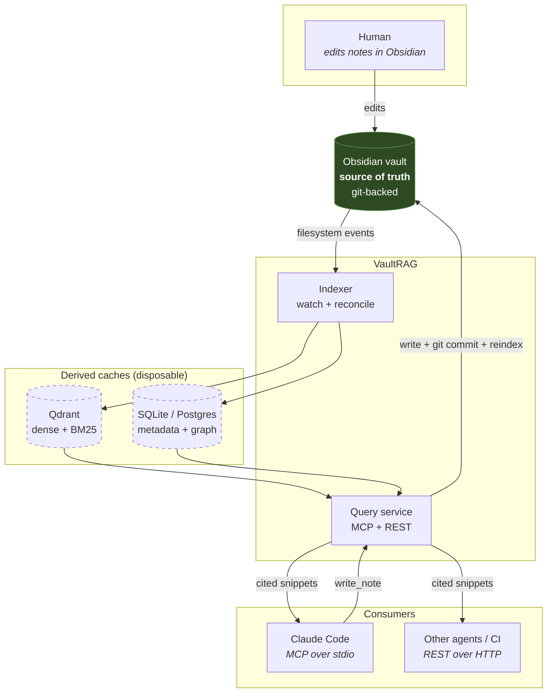
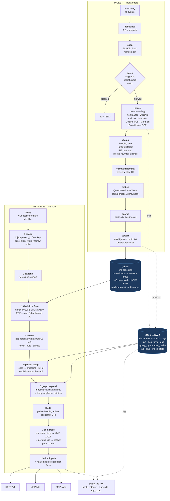
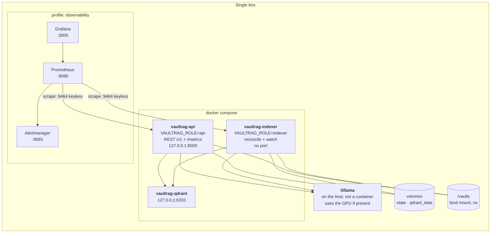
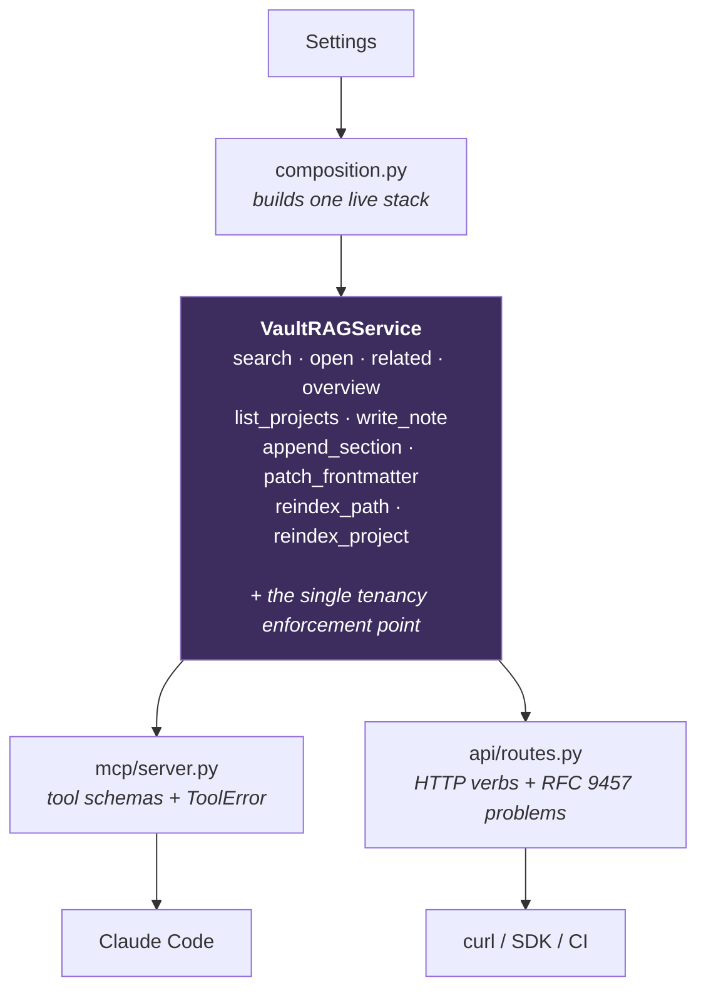
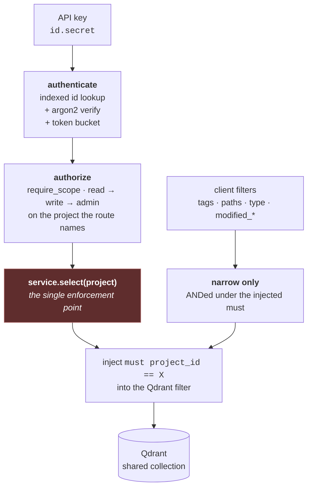
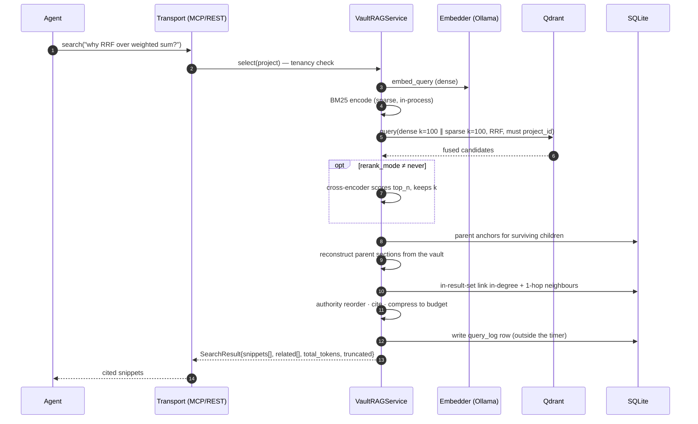
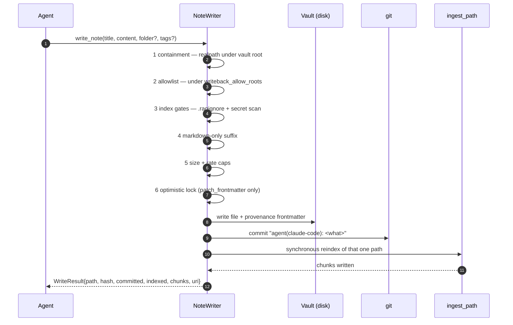
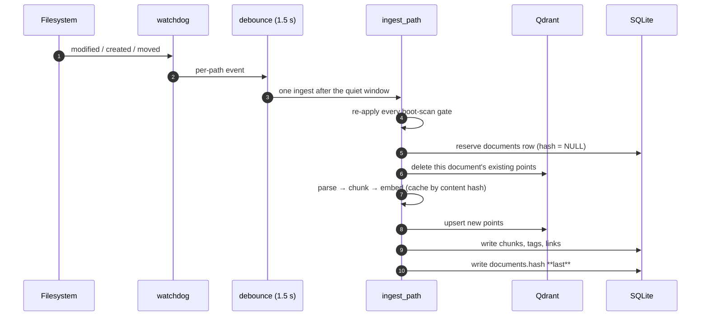

# System design

VaultRAG is a **retrieval backend for coding agents**, not a chatbot. It indexes one or
more Obsidian vaults and serves cited snippets over MCP and REST, and it accepts writes
back into the vault so an agent's findings become part of the corpus.

This document is the system design: what the components are, how data moves, and where
the boundaries sit. For *why* each technique was chosen over its alternative, see
[design decisions](design-decisions.md). For measured behaviour, see
[benchmarks](benchmarks.md).

---

## 1. Design principles

These are load-bearing. A change that violates one is a bug even if its tests pass.

| # | Principle | What it means concretely |
|---|---|---|
| 1 | **The vault is the source of truth; every index, vector and edge is a derived cache.** | Disaster recovery is `vaultrag reindex`. No fact may live only in the index. Parent sections are reconstructed from the vault at query time rather than stored. |
| 2 | **Local-first, $0 software.** | Qdrant, Ollama, SQLite, ONNX. Paid APIs (Voyage, Cohere) are optional plugins behind interfaces, never dependencies. |
| 3 | **MCP is the primary interface.** | REST, CLI and SDK are thin wrappers over one core service object. A REST/MCP divergence is made *impossible* by construction, not merely tested for. |
| 4 | **Return snippets, not answers.** | The consuming agent is already an LLM. Synthesizing an answer server-side burns tokens to lose information. |
| 5 | **Hybrid always.** | BM25 + dense + optional reranker. Dev notes are full of identifiers and error codes; dense-only misses exact matches. |
| 6 | **Tenancy is enforced server-side.** | The `project_id` filter is injected from the key scope. A client filter can narrow, never widen. There is no code path that widens. |
| 7 | **Token frugality is a feature.** | Every response respects `budget_tokens`. Pointers (graph neighbours) are returned outside the budget so they can never displace a result. |

---

## 2. System context



The dashed stores are the point: delete both, run `reindex`, and the system is fully
rebuilt from bare Markdown. The backup is the vault's own git remote.

---

## 3. The RAG architecture, end to end

This is the whole pipeline in one picture — ingest on the left, retrieval on the right.



Note the numbering: stage 8 (cite) executes *before* stage 7 (compress). Citations are
attached before packing so the kept snippets carry them, and a URI is not text so it
costs no budget. The numbers are the design doc's stage names, not an execution order.

---

## 4. Deployment topology

One codebase. One Docker image. A `ROLE` environment switch decides what a container is.



**Why two roles rather than one process.** They fail, restart and scale for different
reasons. An indexer chewing through a 100k-chunk reconcile must not take query serving
down with it, and an api container should be restartable without re-reconciling a vault.

**Why Ollama is on the host.** So it can use a GPU. The containers reach it through
`host.docker.internal`, which the compose file materializes on Linux via `extra_hosts`.

**Both roles open the same SQLite file** on the shared `state` volume. That is fine at
this scale — WAL, a 5 s busy timeout, one writer and one mostly-reader — and it is also
precisely the signal for the Postgres migration. Two containers on one file is the last
stop before that trigger, not a steady state to grow into.

---

## 5. Module map

```
src/vaultrag/
├── config.py         Settings — env-driven, dependency-free leaf
├── models.py         Document · Block · Chunk · Snippet · SearchResult · WriteResult
├── service.py        VaultRAGService — every operation once, transport-neutral errors
├── composition.py    Settings → a live, closable dependency stack
├── cli.py            typer app: reindex · watch · mcp · serve · project · key · queries · eval
├── projects.py       ProjectRegistry — the multi-tenant registry
├── auth.py           argon2 keys · scopes · token-bucket rate limits
├── consistency.py    manifest ↔ vector-store drift detection
├── metrics.py        Prometheus registry + stage timers
├── logging.py        structlog JSON, stderr-only
│
├── parsing/          frontmatter · markdown · obsidian · sections · pdf · mermaid
│                     excalidraw · image(OCR)
├── chunking/         chunker (heading tree) · tokens
├── embedding/        Embedder protocol · ollama impl · (model,dims,hash) cache
├── index/            VectorStore protocol · qdrant · sparse(BM25) · payload
├── store/            MetaStore protocol · sqlite (DDL, jobs, links, query_log, keys)
├── indexer/          scan · secret_guard · pipeline (ingest primitive) · watch
├── retrieval/        pipeline · rerank · parents · graph · compress · cite · querylog
├── writeback/        writer (the gauntlet) · git · errors
├── api/              FastAPI app · routes · deps (auth) · errors (RFC 9457)
├── mcp/              FastMCP tool schemas + ToolError rendering
└── eval/             harness · golden · metrics · replay · ceiling · overlay · report
```

### The one-service architecture

`service.py` is the reason MCP and REST cannot drift.



Before this refactor, parent-resolver wiring, compact mode, the query-log policy, vault
containment and `overview`'s caps all lived inside the FastMCP tool closures — "a thin
wrapper over the same core" was true of retrieval and false of everything else. Now each
transport owns only its own vocabulary: MCP renders `ToolError`, REST renders
`application/problem+json`, and the behaviour underneath is one object.

A cross-process parity test compares what each transport asked the engine for — not just
the responses. Comparing responses alone passed vacuously with `filters=None` hard-coded
into a route, because the fake vector store returned preset hits regardless.

---

## 6. Storage design

### Qdrant — one collection, payload-partitioned

| Property | Value | Why |
|---|---|---|
| Collections | **one** (`chunks`), all tenants | Collection-per-project's per-tenant overhead is what kills you at scale. |
| Named vectors | `dense` (cosine, 1024d) + `bm25` (sparse, IDF modifier) | One round-trip serves both retrievers. |
| Quantization | int8 scalar; quantized in RAM, originals on disk | ≈100 MB RAM at 100k chunks. Measured to track full precision to max Δ 0.0013. |
| HNSW | `m=16`, `ef_construct=128` | Standard quality/build-time point for this corpus size. |
| Tenant key | `project_id`, keyword payload index with `is_tenant: true` | Co-locates a project's points on disk — what keeps per-tenant queries fast at thousands of projects. |
| Other payload indexes | `path`, `tags`, `type`, `modified_ts` | Backs the client-suppliable narrowing filters. |
| Point id | `uuid5(project_id, path, chunk_ix)` | Deterministic — re-running an ingest overwrites rather than duplicating. |
| Upsert batch | 256 | — |

### SQLite (WAL) — metadata, graph, and operational state

| Table | Holds |
|---|---|
| `projects` | The registry: id, vault path, display name, per-project overrides. |
| `documents` | One row per indexed file: path, title, BLAKE3 hash, timestamps. The **manifest**. |
| `chunks` | Chunk metadata mirroring the Qdrant points (drift detection compares counts). |
| `tags` | Prefix-expanded tags (`a/b` → `a`, `a/b`), for filters and `overview`. |
| `links` + `doc_keys` | The wikilink graph. Edges as data; `doc_keys` resolves a link target to a document. |
| `jobs` | Ingest jobs, idempotent by `(project, path, hash)`. A failed path parks as `dead`. |
| `index_state` | Per-project bookkeeping for drift and reconcile. |
| `query_log` | One row per served search. **The only table nothing can rebuild.** |
| `embed_cache` | Keyed `(model, dims, chunk_hash)`. Why a rename re-embeds nothing. |
| `api_keys` | argon2 hashes, scopes, rate limits. Never a plaintext secret. |

The graph is a `links` table plus recursive CTEs — not a graph database, and not full
GraphRAG. See
[design decisions](design-decisions.md#the-graph-is-obsidians-own-wikilinks).

### Filesystem

```
state/                 # gitignored, disposable
├── vaultrag.db        # SQLite, WAL mode
└── ...                # embed cache artifacts
```

---

## 7. Multi-tenancy



Rules that hold everywhere:

- The `project_id` filter is **injected server-side** from the key's scope. A client
  filter is ANDed under it. There is no code path where a client widens scope.
- `SearchFiltersParam` deliberately **has no `project` field**, and sets
  `extra="forbid"` so a misspelled filter key fails loudly instead of silently not
  filtering.
- `list_projects` **over REST is filtered to the caller's scopes**; the MCP tool is not.
  MCP has no keys to filter by — stdio inherits local-user trust for everything. REST is
  the first transport with a narrower caller, and returning every served project to an
  unscoped key would be the same leak, just at discovery instead of at search.
- A **real but unscoped** project answers `403 insufficient-scope`; a **nonexistent** one
  falls through to `404 unknown project`. That distinction is deliberate: it matches what
  MCP already answers for the same typo under a strictly weaker trust model.

**Verified adversarially.** A second project was indexed into the same collection holding
byte-identical note content under `DECOY-` prefixed paths — every decoy chunk a
perfect-duplicate competitor for its twin. Re-running the 72-case eval gave metrics
identical to the digit and zero decoy paths in any ranked list; a direct 12-query probe
showed zero cross-contamination in both directions. Tenancy also held at 100 000
foreign-tenant points in the same collection.

---

## 8. Request flows

### Search



### Write-back — the memory loop



The write is durable in the vault **before** indexing. If Qdrant is down, the note is
still safely written and committed, and the result says `indexed: false` with a warning —
never a silent loss, never a fake success.

### Ingest of one changed file



`hash` is written last on purpose. Every step before it leaves a *half-recorded* document
— exactly the state the manifest diff treats as an update rather than as
create-or-unchanged. A crash mid-ingest therefore leaves the file eligible for
reprocessing, instead of looking done while it isn't.

---

## 9. Failure modes and how they are handled

| Failure | Behaviour |
|---|---|
| **Qdrant unreachable at startup** | Drift is reported as *unknown*, not *drifted* — the process starts, logs, and leaves the drift gauge unset. Publishing `0` would be a lie. |
| **Index drift** (manifest ≠ vector store) | Startup refuses by default (`VAULTRAG_STARTUP_DRIFT_CHECK`), because a drifted index answers every query plausibly from a fraction of the vault. `--allow-drift` waives the refusal, never the measurement. |
| **One bad note during reindex** | Its job parks as `dead`; the rest of the vault continues. `vaultrag_jobs_dead_total` fires an alert. |
| **Crash mid-ingest** | Half-recorded document → reprocessed on the next reconcile. |
| **Shrinking document** (5 chunks → 3) | Every re-ingest deletes the document's existing points *before* writing, so stale ids 3–4 cannot survive. |
| **Rename** | Point ids embed the path, so it is delete-at-old + ingest-at-new. The content-keyed embed cache makes that re-embed nothing. |
| **Concurrent edit during `patch_frontmatter`** | 409 carrying the current hash **and** the current content, so the agent rebases without a second read. |
| **Ollama down during write-back** | Note is written and committed; `indexed: false` + warning. |
| **Two concurrent full reindexes** | Single-flight — the second gets 409. Two reconciles of one vault race on the manifest and the second has nothing to add. |
| **Reranker model unavailable** | `auto`/`always` degrade to a no-op reranker (fusion order). An offline install loses the lift, never the search. |
| **No OCR engine / no Docling** | Images and PDFs are skipped cleanly; the rest of the vault indexes. |

---

## 10. Observability surface

Two front doors to **one** registry:

- The api role's `/metrics`, behind a bearer key.
- A standalone keyless exporter on port 9464, bound to the compose network and never
  published to the host. This is the scrape door — putting a credential in
  `prometheus.yml` to read numbers that carry no vault content is plumbing for nothing.

| Metric | Type | Notes |
|---|---|---|
| `vaultrag_build_info` | gauge | Version/build labels. |
| `vaultrag_ingest_lag_seconds` | histogram | Edit → searchable. **The SLO that matters.** |
| `vaultrag_ingests_total` | counter | By outcome. |
| `vaultrag_jobs_queue_depth` | gauge | — |
| `vaultrag_jobs_dead_total` | counter | Parked failures. |
| `vaultrag_embed_cache_lookups_total` | counter | Hit/miss — the cache's whole value. |
| `vaultrag_search_latency_seconds` | histogram | Labelled by `stage` (`embed`, `fetch`, `rerank`, `parents`, `graph`, `cite`, `compress`, `total`). |
| `vaultrag_searches_total` | counter | By project. |
| `vaultrag_searches_empty_total` | counter | Zero-hit ratio. |
| `vaultrag_rerank_decisions_total` | counter | How often `auto` actually reranked. |
| `vaultrag_write_ops_total` | counter | — |
| `vaultrag_write_refused_total` | counter | By refusal reason. |
| `vaultrag_index_drift_chunks` | **gauge** | Drift is a *state* `reindex --force` clears, not an event. |
| `vaultrag_key_requests_total` | counter | Per `key_id`. |

Histogram buckets are an explicit decade ladder from 0.1 ms to 60 s, because stages span
five orders of magnitude (graph expand 0.39 ms; a fully reranked query ~25 s) and
`prometheus_client`'s defaults (5 ms – 10 s) yield **no p50 or p95 at either end** — a
panel that exists and answers nothing.

Full dashboard and alert-rule detail: [operations](operations.md).

---

## 11. Scaling posture

Designed for **one box**. Measured footprint at 100 260 Qdrant points: 727 MiB of
containers plus ~1 070 MiB of host Ollama ≈ **1.8 GiB** at the shipped default. See
[benchmarks](benchmarks.md#memory-footprint).

Known migration triggers, in the order they will bite:

| Trigger | Move to |
|---|---|
| Two roles contending on one SQLite file under real write load | Postgres 16 (the `MetaStore` protocol already abstracts this). |
| Rerank latency unacceptable on CPU | GPU or a hosted reranker behind the same `Reranker` protocol. |
| Ingest throughput bound by CPU embedding | GPU-backed Ollama, or an ONNX int8 embedder. |
| Vault count into the thousands | The tenant payload index already targets this; watch per-query latency, not collection count. |

Everything above is a **config or deployment change**, not a rewrite — which is the whole
reason `Embedder`, `Reranker`, `VectorStore` and `MetaStore` are protocols.

---

## Related reading

- [Indexing pipeline](indexing.md) — the write path in detail
- [Retrieval pipeline](retrieval.md) — the read path, stage by stage
- [Design decisions](design-decisions.md) — every technique choice and its evidence
- [Security model](security.md) — tenancy, secrets, keys, write-back
- [Benchmarks](benchmarks.md) — the numbers behind the claims here
