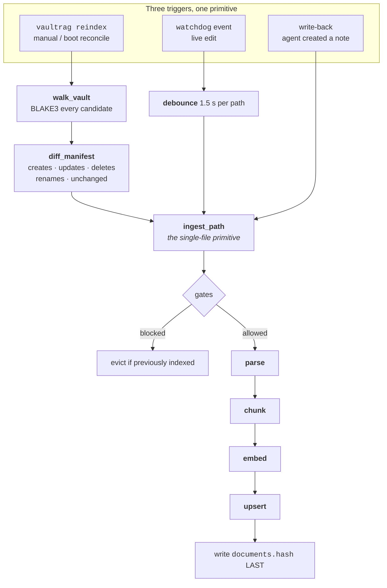
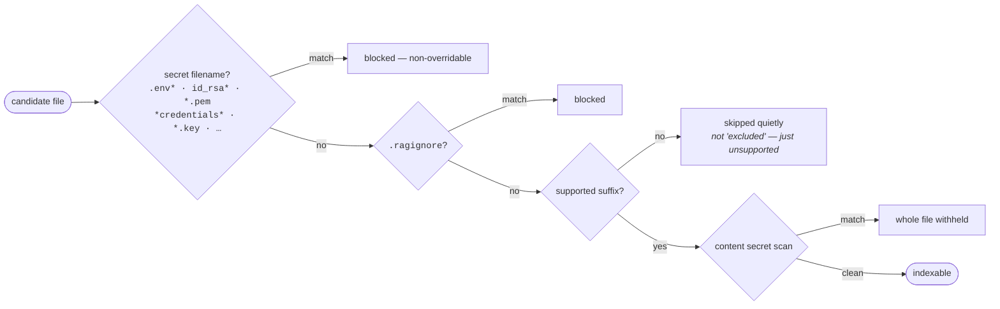
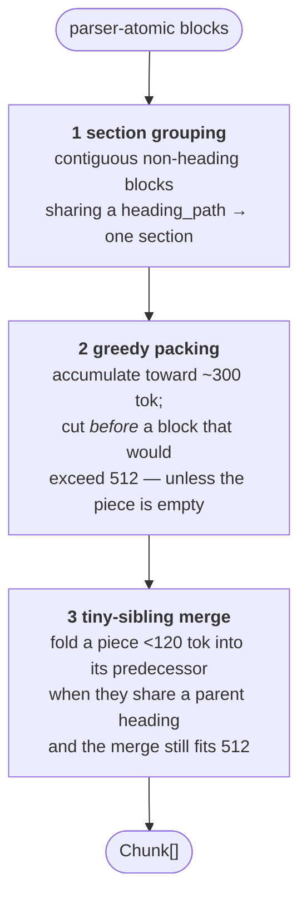

# Indexing pipeline

Vault on disk → searchable index. This is the write path.



Everything funnels through one function. Live watch, boot reconcile and write-back all
drive the **same** `ingest_path`, so a file can never enter the index through one route
that another route would have refused.

---

## 1. Scan and manifest diff

`src/vaultrag/indexer/scan.py`

Walks the vault, BLAKE3-hashes every candidate file, drops anything `.ragignore` or the
built-in secret guard excludes, and diffs the surviving `path → hash` set against the
`documents` manifest.

| Diff class | Detected by | Handled as |
|---|---|---|
| **create** | Path absent from manifest | Full ingest. |
| **update** | Path present, hash differs | Delete-then-reingest. |
| **delete** | Path in manifest, gone from disk | Evict chunks + points. |
| **rename** | **Hash match at a new path**, old path gone | Delete-at-old + ingest-at-new. Re-embeds *nothing*. |
| **unchanged** | Hash matches | Skipped entirely — no parse, no embed, no upsert. |

`diff_manifest` is a **pure function**, so the diff is testable without touching a
filesystem.

A scan of a bare vault against an empty manifest classifies every indexable file as a
create. That property is what makes `vaultrag reindex` a genuine full rebuild — and
therefore what makes "DR = reindex" true rather than aspirational.

### Why renames are not metadata-only

Point ids are `uuid5(project_id, path, chunk_ix)` — the path is *in* the id. A hash match
at a new path cannot be a metadata-only update, because the id itself has to change. So it
is handled as delete-at-old + ingest-at-new.

The re-ingest still costs nothing meaningful: the embed cache is keyed by **content hash**,
not path, so every vector comes straight back out of SQLite.

---

## 2. The gates

Three independent gates, applied at the scan boundary **and again** inside
`ingest_path` — so a live-watch or write-back event can never sneak a file in that a full
`reindex` would withhold.



- **`.ragignore` can only narrow.** The secret guard is enforced *in code*; nothing a user
  configures can shrink it. See [security](security.md#the-secret-guard).
- **A previously-indexed path that later trips a gate is evicted.** Reconcile means "make
  the index match disk for this one path", in both directions.
- **Unsupported suffixes are skipped quietly**, not counted as exclusions, so the scan
  statistics stay meaningful.

---

## 3. Parse

`src/vaultrag/parsing/`

markdown-it-py tokenizes CommonMark + GFM tables. Obsidian's own conventions are layered
on top with dedicated extraction, because they are community/app conventions markdown-it
does not know about.

| Construct | Handling |
|---|---|
| **Frontmatter** | `python-frontmatter`. Tags, aliases, type, created/modified timestamps, arbitrary custom keys. |
| **Wikilinks** | `[[Note]]`, `[[Note\|Alias]]`, `[[Note#Heading]]`, `[[Note#^block]]` → `links` rows. Anchor stored verbatim; resolving it to a slug is a retrieval-time concern. |
| **Embeds** | `![[...]]` → an `embed` edge. **Content is never duplicated** — the target is indexed once under its own path. |
| **Inline tags** | `#tag/nested` → prefix-expanded to `[tag, tag/nested]`. |
| **Callouts** | `> [!note]` headers parsed into `callout_type`. |
| **Dataview inline fields** | `key:: value` extracted as metadata. |
| **Code fences** | Kept **atomic** with their language. Never split. |
| **Tables, lists, blockquotes** | Kept atomic. |
| **PDFs** | Docling → Markdown with page anchors (`--extra pdf`). |
| **Mermaid** | Diagram source extracted; links inside it become graph edges. |
| **Excalidraw** | `.excalidraw` and the plugin's `.excalidraw.md` wrapper. LZ-string `compressed-json` scenes decoded, text elements extracted. |
| **Images** | OCR'd into searchable text when an engine is available. Skipped cleanly otherwise. |

The parser emits a `Document` of **parser-atomic blocks**: the chunker must never split a
code fence or a table, so the parser never fragments them into sub-blocks either.

**Every block's text is secret-scanned at extraction**, before it can reach the heading
stack or the wikilink/tag regexes. Redaction is block-level, not line-level, and that is
deliberate: a PEM private key's *body* lines do not self-identify — only the
`-----BEGIN...` header matches a rule — so scanning line-by-line would strip the header and
leave the key body searchable. Quarantining the whole block closes that gap.

---

## 4. Chunk — the heading tree

`src/vaultrag/chunking/chunker.py`

**Not fixed-size sliding windows.** A child chunk is the contiguous run of non-heading
blocks under the lowest heading in effect.

| Parameter | Value |
|---|---|
| Target size | **~300 tokens** |
| Hard maximum | **512 tokens** |
| Tiny-sibling merge floor | **120 tokens** |

Three passes over the document's blocks:



1. **Section grouping.** Heading blocks are boundary markers only — they never contribute
   chunk text, because their text already surfaces via `heading_path` and the contextual
   prefix. A heading with nothing under it before the next heading yields no chunk, only
   context for its descendants.

2. **Greedy packing.** Packing only ever decides *between* blocks, never inside one. An
   oversized atomic block (a 900-token code fence) becomes its own oversized chunk rather
   than being split.

3. **Tiny-sibling merge.** One left-to-right pass. Covers both a small leftover tail piece
   from packing and genuinely tiny sibling sections — e.g. a "Glossary" H2 full of one-line
   H3 terms. A merged chunk inherits the *earlier* piece's `heading_path`; the later
   piece's content is still present in `text`, just not separately labelled.

### The contextual prefix

Each chunk carries `project ▸ H1 ▸ H2` as a contextual prefix. A chunk that reads "we
rejected this because of the latency" is meaningless alone and precise once it says which
document and which section it came from — and the embedding sees that context.

### Parent pointers

`parent_id` is a **pointer, not a record**: `<path>#<anchor>`, where `anchor` is the
enclosing H1/H2 section's normalized heading.

**No parent text is materialized.** Children are the only indexed vectors; the retrievable
parent is reconstructed on the fly from the vault at swap time
([retrieval stage 5](retrieval.md#stage-5--parent-swap)). That is what keeps the vault the
source of truth.

All children of one section share the same pointer, which is exactly what lets stage 5
dedupe them into a single parent snippet. Root-level content (empty `heading_path`) has no
enclosing section, so its `parent_id` stays `null`.

Chunks also carry `prev_id` / `next_id` for sequential neighbours.

---

## 5. Embed

`src/vaultrag/embedding/`

**Dense:** Qwen3-Embedding-0.6B via Ollama, 1024 dimensions (Matryoshka-truncatable to
512), behind an `Embedder` protocol.

**Sparse:** BM25 via FastEmbed → Qdrant sparse vectors. Zero extra infrastructure, and it
runs in-process.

### Two caches

| Cache | Where | Key | Why |
|---|---|---|---|
| **Chunk cache** | SQLite `embed_cache` | `(model, dims, chunk_hash)` | Content-addressed, so an edited note re-embeds only its *changed* chunks and a pure rename re-embeds nothing. |
| **Query cache** | In-process LRU | query string | Repeat agent queries are common; re-embedding the same string is pure waste. |

Identical chunk bodies embed **once** — `embed_chunks` de-duplicates by `chunk_hash`
before it looks anything up. Vectors cross the store boundary as packed float32 bytes; the
store never sees a float list.

`vaultrag_embed_cache_lookups_total` reports hits and misses. On a mature vault the hit
ratio is the whole reason a reindex is cheap.

---

## 6. Upsert

`src/vaultrag/index/qdrant.py`

| Property | Value |
|---|---|
| Point id | `uuid5(project_id, path, chunk_ix)` — deterministic |
| Batch size | 256 |
| Vectors | `dense` (cosine) + `bm25` (sparse, IDF modifier) |
| Quantization | int8 scalar; quantized in RAM, originals on disk |
| HNSW | `m=16`, `ef_construct=128` |
| Payload indexes | `project_id` (keyword, `is_tenant: true`), `path`, `tags`, `type`, `modified_ts` |

**Delete-then-write, every time.** Point ids are deterministic, so an upsert overwrites
only the ids it writes. If a note goes from 5 chunks to 3, ids 3–4 would survive untouched
in both SQLite and Qdrant. Every re-ingest therefore deletes the document's existing
chunks and points *before* writing the new ones.

---

## 7. Partial-failure safety

A document's `hash` column is written **last**, after its chunks and vectors are fully
upserted. Every step before that reserves the row with `hash = NULL`.

That is a "half-recorded document" — precisely the state `diff_manifest` classifies as an
**update**, not as create-or-unchanged. So a crash mid-ingest leaves the file eligible for
reprocessing on the next reconcile, instead of looking done while it isn't.

Idempotency here is a **correctness requirement, not a nicety**:

- Jobs are keyed `(project, path, hash)`.
- Point ids are `uuid5(project, path, chunk_ix)`.
- The embed cache is keyed `(model, dims, chunk_hash)`.

Re-running any step must not duplicate or corrupt. All three keys exist to guarantee that.

---

## 8. Live watch

`src/vaultrag/indexer/watch.py`

```mermaid
sequenceDiagram
    participant FS as Filesystem
    participant W as watchdog Observer
    participant D as Per-path debounce
    participant P as Worker pool
    participant I as ingest_path

    FS->>W: created / modified / moved / deleted
    Note over W: Obsidian saves via temp files —<br/>one save is an event storm
    W->>D: event for path X
    D->>D: reset 1.5 s quiet window
    D->>P: one job for X after quiet
    P->>I: ingest (up to 4 paths in parallel)
    Note over P,I: per-path work stays serial;<br/>last write wins
```

| Setting | Default | Meaning |
|---|---|---|
| `watch_debounce_seconds` | `1.5` | Per-path quiet window. |
| `watch_workers` | `4` | How many *distinct* files ingest in parallel. |

Ownership: `serve --role indexer` (and standalone `vaultrag watch`) run the watcher.
`vaultrag mcp` runs it only with `--watch`, in daemon threads, for solo dogfooding — *N*
concurrent agent sessions each running a watcher would be *N* redundant reconciles of one
vault.

**Boot reconcile first, always.** The watcher can only see events that happen while it is
running; anything that changed while it was down is caught by the scan at startup.

---

## 9. Jobs and failure isolation

In-process asyncio plus a SQLite `jobs` table — no Redis, no Celery. At this scale a
broker is a second system to operate for no gain, and the durability that matters
(idempotent re-derivation from the vault) is already provided by the manifest.

- A path that exhausts its retries is parked as **`dead`**. One bad note cannot abort the
  rest of the vault.
- `vaultrag_jobs_dead_total` fires the `VaultRAGDeadJobs` alert on
  `increase(...[15m]) > 0` — an *event*, not a latched `> 0`, so a second incident can
  re-fire.
- `vaultrag_jobs_queue_depth` shows backlog.

---

## 10. Drift detection

`src/vaultrag/consistency.py`

The manifest (SQLite) and the vector store can disagree — most commonly because Qdrant
lost data the manifest still records. An ordinary `reindex` **cannot detect this**: every
hash still matches, so every document reports `unchanged`.

Drift is therefore measured explicitly and published as
`vaultrag_index_drift_chunks{project}` — a **gauge**, because drift is a *state* that
`reindex --force` clears, not an event.

| Situation | Behaviour |
|---|---|
| Drift detected at startup | Refuse to start (`VAULTRAG_STARTUP_DRIFT_CHECK`, default on). A drifted index answers every query plausibly from a fraction of the vault — the failure it catches is **silent**. |
| `--allow-drift` | Start anyway. The drift is still measured and logged; only the refusal is waived. |
| **Qdrant unreachable** | Drift is **unknown**, not drifted. Skip, log, leave the gauge unset. Publishing `0` would be a lie, and a store that answers nothing is the least silent failure there is — refusing to boot would trade a loud recoverable error for a dead agent session. |

Fix: `vaultrag reindex --project X --force`.

---

## Measured behaviour

| Metric | Value | Conditions |
|---|---|---|
| Cold index | 67 documents → 261 chunks in **326 s** | CPU-only, host Ollama, Docker DR drill |
| Warm re-index (no changes) | **95–139 ms** | Full manifest scan, zero ingests |
| Ingest lag SLO | p95 < 300 s | `VaultRAGIngestLagHigh` alert |

Full methodology: [benchmarks](benchmarks.md).

---

## Related reading

- [Retrieval pipeline](retrieval.md) — what happens to these chunks at query time
- [Design decisions](design-decisions.md#heading-tree-chunking) — why heading-tree over fixed-size
- [Security model](security.md#the-secret-guard) — the gates in full
- [Operations](operations.md) — alerts on the metrics above
