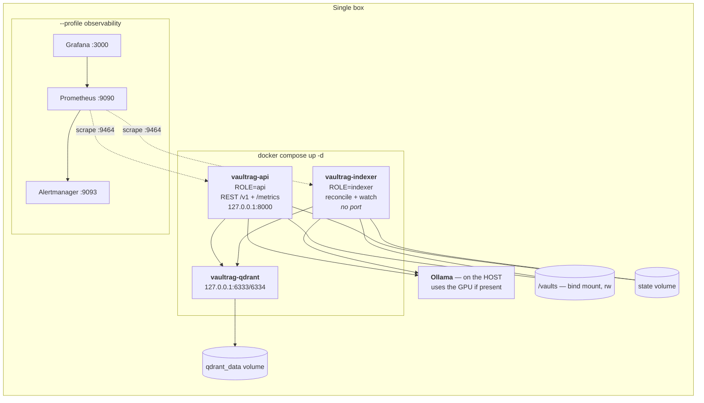
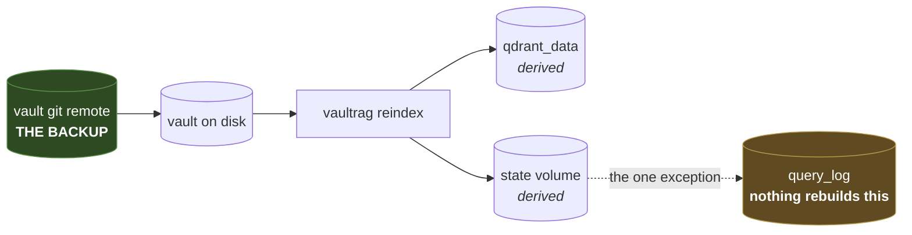

# Operations

Running VaultRAG on a box: deployment, observability, alerting, backup, and the runbook for
when something is wrong.

**The compose file *is* the deployment.** Moving from a laptop to a VPS changes config,
never code.

---

## Deployment

### Topology



### First deploy

```bash
# 1. Ollama on the host — not a container, so it can use a GPU
ollama pull qwen3-embedding:0.6b

# 2. Vaults where the containers can see them
mkdir -p vaults && cp -R ~/my-notes vaults/
cat >> .env <<'EOF'
VAULTRAG_VAULTS_DIR=/absolute/path/to/vaults
VAULTRAG_UID=1000
VAULTRAG_GID=1000
EOF

# 3. Register + index BEFORE the first `up` — the services refuse to start unconfigured.
#    `run --rm`, not `exec`: nothing is running yet.
docker compose run --rm api project add mydocs --vault /vaults/my-notes
docker compose run --rm api reindex --project mydocs

# 4. Up
docker compose up -d --build

# 5. The bootstrap key is printed once
docker compose logs api | grep -i "api key"
```

`VAULTRAG_UID`/`GID` must own the vault on the host, or write-back fails on permissions.

### Two image tags

| Tag | Build | Contains | Size |
|---|---|---|---|
| `vaultrag:latest` | `docker build -t vaultrag:latest .` | Everything but PDF ingestion | **757 MB** |
| `vaultrag:formats` | `docker build -t vaultrag:formats --build-arg EXTRAS=--extra=pdf .` | + Docling + OCR | +≈2.5 GB |

The base image skips PDFs cleanly and indexes the rest of the vault. The `formats` build
**asserts Docling and an OCR engine actually import**, so a broken extra fails the build
rather than shipping an image that quietly has no PDF support.

Point compose at it with `EXTRAS: --extra=pdf` in the `build.args` block.

### Running the image without compose

```bash
docker run --rm -p 127.0.0.1:8000:8000 \
  -e VAULTRAG_API_HOST=0.0.0.0 \
  -e VAULTRAG_QDRANT_URL=http://host.docker.internal:6333 \
  -e VAULTRAG_OLLAMA_URL=http://host.docker.internal:11434 \
  -v "$PWD/vaults:/vaults:rw" -v vaultrag_state:/state \
  vaultrag:latest serve --role api
```

The entrypoint is `vaultrag`, so you pass only the subcommand.

`VAULTRAG_API_HOST` is **not defaulted in the image**: the code default is loopback, and
inside a container that makes the port unreachable. Compose sets it next to the
loopback-only publish, so both halves of the decision live in one file.

### Everyday commands

```bash
docker compose ps
docker compose logs -f api
docker compose logs -f indexer
docker compose exec api project list
docker compose exec api key list
docker compose exec api reindex --project mydocs --force
docker compose restart indexer
docker compose down                 # keeps volumes
docker compose down -v              # DESTROYS the derived caches (recoverable by reindex)
```

---

## Observability

```bash
docker compose --profile observability up -d
open http://127.0.0.1:3000     # Grafana — dashboard provisioned
open http://127.0.0.1:9090     # Prometheus — /alerts shows rule state
```

### Two front doors, one registry

| Door | Auth | Reachable from |
|---|---|---|
| `GET /metrics` on the api | **bearer key required** | Wherever the api is reachable |
| Standalone exporter, port **9464** | **keyless** | The compose network only — never published to the host |

Prometheus scrapes the keyless one. Putting a credential in `prometheus.yml` to read numbers
that carry no vault content is plumbing for nothing. Same registry either way.

### Scrape targets

```yaml
scrape_configs:
  - job_name: vaultrag
    static_configs:
      - targets: ["api:9464"]
        labels: { role: api }
      - targets: ["indexer:9464"]
        labels: { role: indexer }
  - job_name: qdrant
    static_configs: [{ targets: ["qdrant:6333"] }]
  - job_name: prometheus
    static_configs: [{ targets: ["localhost:9090"] }]
```

### Metrics

| Metric | Type | Labels | Watch it for |
|---|---|---|---|
| `vaultrag_build_info` | gauge | version | Which build is live. |
| `vaultrag_ingest_lag_seconds` | histogram | `project` | **Edit → searchable. The SLO that matters.** |
| `vaultrag_ingests_total` | counter | outcome | Ingest success/skip/fail mix. |
| `vaultrag_jobs_queue_depth` | gauge | `project` | Backlog. |
| `vaultrag_jobs_dead_total` | counter | `project` | Parked failures — vault and index disagree. |
| `vaultrag_embed_cache_lookups_total` | counter | hit/miss | Why a reindex is cheap. |
| `vaultrag_search_latency_seconds` | histogram | `stage` | Per-stage breakdown + `total`. |
| `vaultrag_searches_total` | counter | `project` | Traffic. |
| `vaultrag_searches_empty_total` | counter | `project` | Zero-hit ratio — a retrieval-quality signal. |
| `vaultrag_rerank_decisions_total` | counter | decision | How often `auto` actually reranked. |
| `vaultrag_write_ops_total` | counter | op | Write-back volume. |
| `vaultrag_write_refused_total` | counter | reason | **Which guardrail is firing.** |
| `vaultrag_index_drift_chunks` | **gauge** | `project` | Manifest ↔ vector-store disagreement. |
| `vaultrag_key_requests_total` | counter | `key_id` | Per-key traffic. |

`stage` labels: `embed`, `fetch`, `rerank`, `parents`, `graph`, `cite`, `compress`, `total`.
They are the same names the [retrieval docs](retrieval.md) use, so a Grafana panel and the
design doc talk about the same things. `total` is **not** the sum of the parts — it also
carries the untimed glue.

**Buckets are an explicit decade ladder, 0.1 ms → 60 s**, because stages span five orders of
magnitude (graph 0.39 ms; a fully reranked query ~25 s) and `prometheus_client`'s defaults
(5 ms – 10 s) yield no p50 or p95 at either end.

### The dashboard

Provisioned at `deploy/grafana/dashboards/vaultrag.json`. Four rows:

| Row | Panels |
|---|---|
| **Fleet** | Roles up · Index drift (chunks) · Build · Authenticated requests by key |
| **Search** | Searches/s · Zero-hit ratio · Search latency p95 by stage · Top projects by search rate · Rerank decisions · Embed cache hit ratio |
| **Write-back** | Write ops and refusals |
| **Ingest health** | Queue depth · Dead jobs (15m) · Ingest lag p95 (edit → searchable) · Ingests by outcome |

**The dashboard is verified mechanically, not by eyeballing it.** A panel querying a renamed
metric renders an empty graph forever and looks exactly like a healthy system.
`tests/test_deploy.py` (21 tests) resolves every `vaultrag_*` name and every label in the
dashboard JSON and the alert rules against the **live metric registry**, and the scrape
config against the compose services and `Settings.metrics_port`. A live run then executed
every panel expression against the running Prometheus: **16/16 returned data, 5/5 rules
loaded and evaluated.**

---

## Alerting

Five rules in `deploy/alerts.yml`. Three from the design's monitoring note, two the
single-box shape makes worth having.

| Alert | Expression | Severity | Meaning |
|---|---|---|---|
| **VaultRAGDeadJobs** | `increase(vaultrag_jobs_dead_total[15m]) > 0` | critical | A path exhausted its retries. The vault and the index now disagree about it. |
| **VaultRAGIngestLagHigh** | `histogram_quantile(0.95, …ingest_lag…) > 300` for 5m | warning | Edits taking >5 min to become searchable. |
| **VaultRAGSearchLatencyHigh** | `histogram_quantile(0.95, …{stage="total"}) > 1` for 10m | warning | Search p95 above 1 s. |
| **VaultRAGRoleDown** | `up{job="vaultrag"} == 0` for 2m | critical | A role is not being scraped. |
| **VaultRAGIndexDrift** | `vaultrag_index_drift_chunks != 0` for 15m | warning | Manifest ↔ vector store disagreement. |

Three details in those expressions are load-bearing:

- **`increase(...)`, not `> 0`, for dead jobs.** A counter `> 0` would latch until the
  process restarts and could not re-fire for a second incident. `increase` asks the question
  the note actually means: has anything died *recently*.
- **p95, not max, for ingest lag.** One pathological 300-page PDF should not page an
  operator; a systematically slow pipeline should.
- **Scrape liveness detects a dead indexer, not ingest lag.** This corrected a design
  assumption: an indexer that is **gone** stops producing lag observations entirely, so lag
  is the wrong detector. Verified by deliberately stopping the indexer — `VaultRAGRoleDown`
  went `firing` → Alertmanager `active` → routed to the webhook, and cleared when the
  indexer came back.

### Routing

The default route goes **nowhere on purpose** — a route that shipped somewhere real out of
the box would publish this box's operational state the moment the profile came up.

```bash
echo 'VAULTRAG_ALERT_WEBHOOK=https://ntfy.sh/your-random-topic' >> .env
docker compose --profile observability up -d alertmanager
```

Alertmanager expands no environment variables in its own config, and a config containing a
literal `${VAR}` fails to parse — so compose substitutes the one value an operator actually
changes *before* Alertmanager reads the file.

---

## Backup and disaster recovery

### What is a backup and what is not



**The vault's git remote is the backup.** Everything in `state` and `qdrant_data` is a
derived cache: delete both, `docker compose up -d`, `vaultrag reindex`, and the system is
fully rebuilt from bare Markdown.

Qdrant snapshots and a SQLite copy are a restore-**speed** optimization, not a backup.

**One exception: `query_log`.** It is the only table nothing can reconstruct. If you rely on
the mining loop, back it up.

```bash
docker compose exec api sh -c 'sqlite3 /state/vaultrag.db ".backup /state/backup.db"'
docker compose cp api:/state/backup.db ./query-log-backup.db
```

### Full DR procedure

```bash
# 1. Nuke everything derived
docker compose down -v

# 2. Restore the vault from its git remote
git clone <vault-remote> vaults/my-notes

# 3. Rebuild
docker compose up -d qdrant
docker compose run --rm api project add mydocs --vault /vaults/my-notes
docker compose run --rm api reindex --project mydocs
docker compose up -d
```

**This has been run for real, not asserted.** Fresh volumes → `git clone` → compose up →
reindex → search: 67 documents → 261 chunks in **326 s** on CPU, and search returned correct
**cited** results with `obsidian://` links and line ranges. Write-back also worked through
the container (rw mount, `git` in the image, auto-commit, synchronous reindex).

---

## Capacity planning

Measured at **100 260 Qdrant points**:

| Component | RSS |
|---|---|
| api container | 144 MiB |
| indexer container | 130 MiB |
| qdrant container | 453 MiB |
| **containers total** | **727 MiB** |
| host Ollama | +1 070 MiB |
| **system total** | **≈1.8 GiB** |
| *reranker, if enabled* | **+1 068 MiB** |

Three planning rules:

1. **Size the box against the ingest peak, not idle.** Qdrant's RSS falls ~280 MiB once
   indexing settles (dense vectors `on_disk`, int8 `always_ram`).
2. **The reranker roughly doubles the footprint.** Enabling it is a memory decision.
3. **Budget ~5 s per document for a cold CPU index.** A GPU-backed Ollama changes this
   dramatically; nothing else does.

**Not measured:** the 100k points were synthetic, and SQLite was never taken past 67 real
documents.

### Migration triggers

| Signal | Move to |
|---|---|
| Both roles contending on one SQLite file under real write load | Postgres 16 (the `MetaStore` protocol already abstracts it). |
| Rerank latency unacceptable | GPU or a hosted reranker behind the `Reranker` protocol. |
| Ingest bound by CPU embedding | GPU-backed Ollama, or an ONNX int8 embedder. |

All three are config or deployment changes, not rewrites.

---

## Runbook

### Alert: `VaultRAGRoleDown`

1. `docker compose ps` — is the container up?
2. `docker compose logs --tail=200 <role>` — startup refusal, or a crash loop?
3. Common causes: unconfigured project (`serve` refuses by design), index drift refusal,
   Qdrant not healthy yet, vault mount permissions.
4. `docker compose restart <role>`.

> The indexer has no port and no dashboard of its own. Without this alert, an indexer that
> died looks exactly like a vault nobody edited.

### Alert: `VaultRAGIndexDrift`

The manifest and the vector store disagree. **Positive means Qdrant is missing chunks SQLite
records** — search answers from a fraction of the vault and looks fine doing it.

```bash
docker compose exec api reindex --project <project> --force
```

An ordinary reindex **cannot** fix this: every hash still matches, so every document reports
`unchanged`. `--force` is the repair.

### Alert: `VaultRAGDeadJobs`

A path exhausted its retries and was parked.

1. `docker compose logs indexer | grep -i dead` — which path, and why.
2. Fix the cause (malformed frontmatter, an unparseable PDF, a permissions problem).
3. `reindex --force`.

### Alert: `VaultRAGIngestLagHigh`

Edits taking >5 minutes to become searchable.

1. Is Ollama alive and responsive? `curl http://127.0.0.1:11434/api/tags`
2. Check `vaultrag_jobs_queue_depth` — is this a backlog or a per-file slowdown?
3. Check `vaultrag_embed_cache_lookups_total` — a collapsed hit ratio means something is
   re-embedding everything (a model change, or a chunker change that altered chunk text).
4. Large PDFs are legitimately slow. Consider the base image if PDF ingestion is not needed.

### Alert: `VaultRAGSearchLatencyHigh`

Break it down by stage on the dashboard:

| Slow stage | Points at |
|---|---|
| `embed` | Ollama |
| `fetch` | Qdrant |
| `rerank` | The cross-encoder — **~500 ms per passage on CPU.** Lower `rerank_top_n` or switch to `auto`/`never`. |
| `parents` | Vault filesystem reads |

### "Search returns nothing useful"

This is a retrieval-quality problem, not an outage. Use the log:

```bash
docker compose exec api queries --project <p> --report worst --limit 30
docker compose exec api queries --project <p> --export candidates.json --max-score <cutoff>
```

Then fill in `expected_paths`, add them to a golden set, and the eval harness scores them
forever after. That is the loop from "retrieval felt bad" to "a test now catches it".

**Use `--report worst`, not `--report zero-hit`.** A hybrid retriever ranks *something*
first for any query — measured, a Stripe question returned eight confident hits from a vault
that has never heard of Stripe.

### "The API returns 401 and I lost the key"

```bash
docker compose exec api key list        # ids only — the secret is gone for good
docker compose exec api key add --name replacement --scope <project>:admin
docker compose exec api key revoke <old-id>
```

There is no recovery path for a lost secret. That is the point of hashing it.

### Rotating keys

```bash
docker compose exec api key add --name new-ci --scope mydocs:read --rate-limit 120
# update the consumer, verify it works
docker compose exec api key revoke <old-id>     # effective on its very next request
```

---

## Upgrading

```bash
git pull
docker compose build
docker compose up -d
```

Then check:

1. `docker compose logs api | head` — did startup refuse for drift?
2. `docker compose exec api eval` — did retrieval quality move?
3. If the chunker or embedding model changed: `reindex --force`, and re-record the eval
   fixture (`vaultrag eval --record`).

Any change to chunking parameters, embedding model, fusion weights or rerank config **must**
run the eval harness. Regressions block merge — that is what makes model swaps safe instead
of vibes.

---

## Related reading

- [Getting started §Docker](getting-started.md#path-b--docker) — first deploy, step by step
- [Configuration](configuration.md) — every setting
- [Security model](security.md#deployment-checklist) — the pre-flight checklist
- [Troubleshooting](troubleshooting.md) — symptom-first index
- [Benchmarks](benchmarks.md#memory-footprint) — the numbers behind capacity planning
