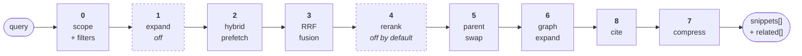
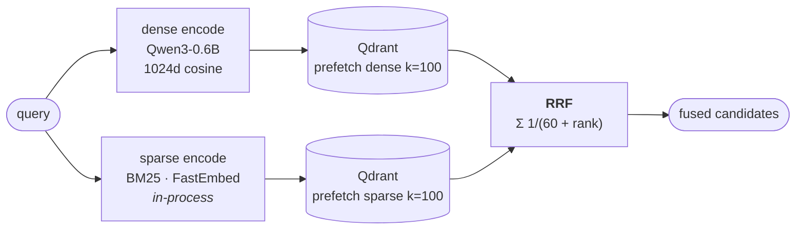
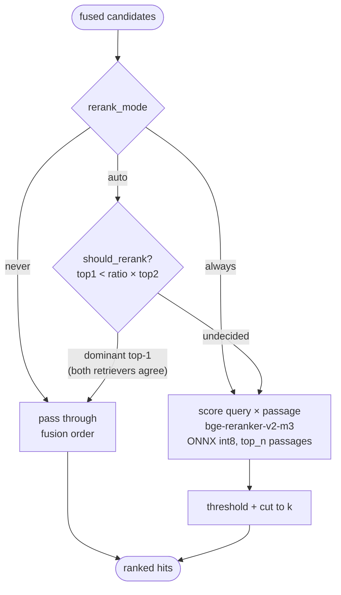
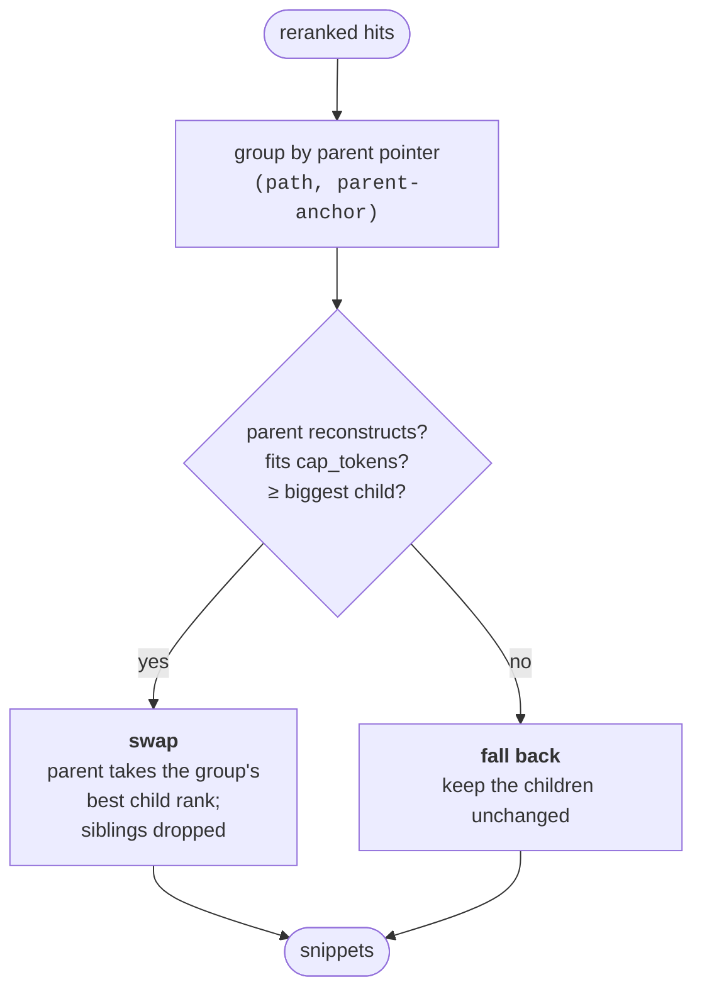
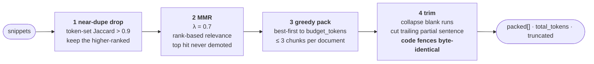

# Retrieval pipeline

Query in, **cited snippets** out. Nine numbered stages, of which seven run by default.

Each stage is its own module and each opts in through a parameter being non-`None`, so a
caller composes exactly the pipeline it wants — which is also what makes A/B evaluation of
a single stage a one-flag operation.



> **Execution order vs numbering.** Stage 8 (cite) runs before stage 7 (compress).
> Citations are attached before packing so the kept snippets carry them, and a URI is not
> text so it costs no budget. The numbers are the design vocabulary; the arrows are the
> code.

Source: `src/vaultrag/retrieval/pipeline.py` sequences the stages;
`rerank.py`, `parents.py`, `graph.py`, `cite.py`, `compress.py`, `querylog.py` each own one.

---

## Stage 0 — scope and filters

**What it does.** Injects the tenancy filter, then ANDs whatever the client asked to
narrow by.

The `project_id` filter is the caller's job to inject **server-side** from the API-key
scope. A client-supplied `filters` object can only ever narrow further — the same rule the
vector store enforces one layer down.

**Client-suppliable filters** (`SearchFiltersParam`, shared verbatim between the MCP tool
schema and the REST body — one class, so a filter cannot narrow differently over HTTP than
over stdio):

| Field | Type | Semantics |
|---|---|---|
| `tags` | `list[str]` | Keep chunks tagged with **any** of these. Nested tags are prefix-expanded, so `project` also matches `project/vaultrag`. |
| `paths` | `list[str]` | Keep chunks from **any** of these exact vault-relative note paths. |
| `type` | `str` | Exact document type, e.g. `note`. |
| `modified_after` | `int` | Epoch seconds, **inclusive**. |
| `modified_before` | `int` | Epoch seconds, **exclusive**. |

`SearchFiltersParam` deliberately has **no `project` field**, and sets `extra="forbid"` so
a misspelled key fails loudly instead of silently not filtering.

An empty or whitespace-only query short-circuits to an empty result — it never reaches the
index, and is deliberately **not** counted in `vaultrag_searches_total` or written to the
query log. Scoring it as an empty *result* would blame retrieval for a caller bug and
drift the metric that exists to watch exactly that.

---

## Stage 1 — query expansion

**Default-off and unbuilt.** Reserved in the sequence so the numbering matches the design
vocabulary. Expanding a query costs an LLM call the rest of this pipeline deliberately
avoids, and the measured evidence for it on identifier-heavy dev notes is not there.

---

## Stages 2–3 — hybrid prefetch and RRF fusion

**One Qdrant round-trip does both.**



| Parameter | Default | Meaning |
|---|---|---|
| `prefetch_limit` | 100 | Candidates pulled per retriever before fusion. |
| `fetch_limit` | `k`, or `max(rerank_top_n, k)` when reranking | How many survive fusion. |

**Why hybrid is non-negotiable.** Developer notes are full of things a dense embedder
cannot represent: `ERR_CONN_RESET`, `MERIDIAN_DEDUPE_TTL_SECONDS`, `MER-1422`,
`docker-compose.prod.yml`. BM25 finds those verbatim; the bi-encoder finds the
paraphrases. Either alone has a whole class of query it reliably misses.

**Why RRF and not a weighted score sum.** BM25 scores and cosine similarities are not
commensurable and their scales drift with corpus and query. Reciprocal Rank Fusion uses
only **rank**, which makes it scale-free and tuning-free: a chunk ranked #1 by *both*
retrievers scores roughly twice one that only one retriever surfaced. That property is
also what makes stage 4's `auto` gate possible — see below.

**Both filters apply inside both branches.** The tenancy `must` and the client narrowing
go into each prefetch, not into a post-filter, so neither retriever can return points the
other's filter would have excluded.

---

## Stage 4 — cross-encoder rerank

**Off by default. This is a latency decision, not a quality one.**



| Setting | Default | Notes |
|---|---|---|
| `rerank_mode` | `never` | `never` · `auto` · `always` |
| `rerank_model` | `onnx-community/bge-reranker-v2-m3-ONNX` | No torch, no transformers — onnxruntime directly. |
| `rerank_model_file` | `onnx/model_int8.onnx` | int8 export for CPU. |
| `rerank_top_n` | `20` | Passages fed to the cross-encoder. **Cost is linear in this.** |
| `rerank_threshold` | `0.0` | Absolute score floor. Default = no floor. |
| `rerank_dominant_ratio` | `1.5` | The `auto` decision boundary. |

### Why it is a mode, not a boolean

Two golden sets disagree, and **both are right**:

| Golden set | Character | Fusion | Reranked |
|---|---|---|---|
| P1 design vault (58 cases) | *Title-matchy* — queries share tokens with the target's title | recall@10 **1.00** / MRR@5 **0.775** | 0.95 / 0.743 |
| P2 Meridian corpus (72 cases) | *Deliberately paraphrased* — most queries share no title token | MRR@5 **0.892** | **0.928** (`always`@50) |

Same model, two query distributions. A single global boolean has to be wrong on one of
them. So the choice is a mode, and `auto` decides **per query**.

### How `auto` decides — no LLM, no classifier

The signal is the **top-1 / top-2 RRF margin**, which is a real statement about *retriever
agreement*, not a heuristic about query text. A dominant top-1 means both dense and BM25
independently put the same chunk first — the known-item case, where a cross-encoder has
nothing to add and everything to lose.

```python
if top1 < dominant_ratio * top2:   # undecided → rerank
```

It is arithmetic on scores fusion already computed, so `auto` costs **nothing** to decide
and only ever saves model calls. Measured: it skips 37.5 % of the corpus queries.

### Deeper reranking is actively *worse*, not just slower

Measured on the 72-case corpus:

| Config | MRR@5 |
|---|---|
| fusion only | 0.892 |
| `always` @ top_n=50 | 0.928 |
| `always` @ top_n=5 | 0.939 |
| **`auto` @ top_n=5** | **0.946** |

Past the useful depth there are no winnable cases left but plenty of distractors, and a
distractor scored high enough displaces a correct chunk. **The cheapest config is also the
best.**

The useful depth is computable **with no model, in seconds**: a cross-encoder can only
promote a chunk it is shown, so the ceiling is how deep the correct note already sits in
*fusion* order. That is `vaultrag eval --ceiling`. Coverage saturates at fusion rank **5**
on the corpus fixture and **14** on the live design vault — hence the default of 20, which
clears the deeper vault with headroom without being fitted to one sample's exact maximum.

### The latency cost

Measured on Apple Silicon, onnxruntime CPU: **~500 ms per passage** (`model_int8` 502 ms,
`model_quantized` 509 ms — quantization is not the bottleneck). At `top_n=20` that is
**~10 s per reranked query**; at the old default of 50, ~25 s.

`search` is an interactive tool an agent blocks on. That is why the default is `never`.
Take the lift with `always` plus a small `top_n` on hardware that can afford it, or put a
GPU/API reranker behind the same `Reranker` protocol.

**It also costs memory:** the reranker alone is **+1 068 MiB** resident — the largest
single component of the system. `rerank_mode` is a memory decision as much as a latency
one.

**Graceful degradation.** If the model cannot be fetched, `auto`/`always` fall back to a
no-op reranker that preserves fusion order. An offline install loses the lift, never the
search.

---

## Stage 5 — parent swap

**On by default.** Precision of children, coherence of parents.

Small chunks rank precisely, but a lone child is often too little context to answer from.
Stage 5 swaps a surviving child for its **enclosing H1/H2 section**, and dedupes children
sharing that section into a single parent snippet.



**The parent is reconstructed live from the vault, never stored.** The chunker records
only a `<path>#<anchor>` pointer; stage 5 slices the section out of the *current* file
using the same machinery the `open` tool uses. That is what keeps the vault the single
source of truth and the index a pure derived cache.

**The three conditions all matter:**

- *Reconstructs* — the anchor still resolves in today's file.
- *Fits* `cap_tokens` = `min(parent_max_tokens, budget_tokens)` — a section that cannot
  fit the response budget should fall back to the child, not evict it.
- *At least as large as its biggest child* — a parent **smaller** than the child means
  that child's `heading_path` spanned more than one section (a tiny-sibling merge), so
  swapping would *lose* content.

| Setting | Default |
|---|---|
| `parent_swap_enabled` | `true` |
| `parent_max_tokens` | `2000` |

**Why on by default when rerank is not:** unlike rerank, this stage does not move *which
notes* rank — it repackages within a note. It is golden-set-neutral while giving the agent
coherent sections instead of fragments.

**Downstream consequence worth knowing.** A swapped parent has no stored vector
(`chunk_id=None`). That single fact is why stage 7's similarity metric is lexical rather
than embedding cosine — see below.

---

## Stage 6 — graph expand

**On by default, and that is a measured claim.** Two independent halves, one flag.

### (a) Authority boost

A chunk whose document is linked *from other documents in the same result set* is, by the
vault author's own hand, the note the others defer to. BM25 and the bi-encoder score a
chunk against the query in isolation, never against what the rest of the vault says about
it. This is a genuine relevance signal fusion cannot see.

In-degree is counted **only within the result set** — query-conditional, not a global
PageRank. Otherwise every map-of-content note would dominate every search it grazes.

**The boost is a fraction of the result set's own score spread, not an absolute bonus.**
Incoming scores are RRF (~0.016 and down), a cross-encoder sigmoid in [0,1], or a constant
1.0 from the no-op reranker. Any fixed number would be a no-op on one scale and a wrecking
ball on another. Scaling by `max − min` gives the knob one scale-free meaning, and buys the
safety property the stage rests on:

> **A chunk can only overtake another if it was already within `boost × spread` of it.**
> Authority settles a photo-finish; it never overturns a decisive win.

The measured sweep is exactly the shape that bound predicts:

| `graph_boost` | Meridian corpus (72) | Live design vault (58) |
|---|---|---|
| 0.10 | MRR@5 0.892 (+0.000) | MRR@5 0.730 (+0.014) |
| **0.25 (default)** | MRR@5 0.892 (+0.000) | MRR@5 **0.749 (+0.033)** |
| 0.50 | MRR@5 0.891 (−0.000) | MRR@5 0.778 (+0.062) |
| 1.00 | MRR@5 **0.741 (−0.151)** | MRR@5 0.719 (+0.003) |

0.50 measured better on the design vault, but **0.25 is the conservative point that is
non-negative on both sets** — and it is a per-vault knob with this sweep as the evidence
for raising it. At 1.00, past the bound, the stage is actively destructive.

### (b) Neighbour append

The 1-hop links and backlinks of the top few result documents come back as **titles and
paths only**, in a separate `SearchResult.related` field.

**Never as text, and never merged into `snippets`.** A pointer costs zero `budget_tokens`
and can never displace a ranked result. Merging them would also make pointers
indistinguishable from retrieved results and **silently inflate every recall number the
gate computes**.

| Setting | Default | Meaning |
|---|---|---|
| `graph_expand_enabled` | `true` | The whole stage. |
| `graph_boost` | `0.25` | Max share of the score spread authority can buy. `0` disables the reorder, keeps the append. |
| `graph_top_docs` | `3` | How many top documents seed the neighbour append. |
| `graph_max_related` | `10` | Cap on appended pointers, so a hub note can't flood the response. |
| `graph_max_tag_siblings` | `5` | Cap on shared-tag siblings in `related`. |

**Cost:** p50 **0.39 ms** / p95 **0.66 ms** over 58 live queries — pure SQLite, ~10× under
budget. None of rerank's latency argument applies, which is why "on by default" is free.

**A finding only dogfooding produced:** `related` initially returned 49 entries — 1 link,
2 backlinks, and **46 tag siblings** — because `tags` is prefix-expanded and one shared
`project/…` namespace makes every note a weak sibling of every other. Hence
`graph_max_tag_siblings`, defaulting to 5. Raise it on a vault with a flat, meaningful tag
vocabulary.

---

## Stage 8 — cite

Runs before stage 7 so the kept snippets carry their citations.

Every snippet already holds `path`, `heading_path`/`anchor`, `line_start`/`line_end` and
`score` from when it was built. Stage 8 adds the one thing that reaches *outside*
VaultRAG: a working `obsidian://open?vault=<name>&file=<path>` URI.

Both components are percent-encoded with `safe=""`, so `/` becomes `%2F` and subfolder
paths with spaces round-trip exactly — `a folder/note.md` opens the right file, not a
sibling with a similar name.

The vault's Obsidian **display name** is not derivable from its path (a vault at
`/home/anik/Documents/Rag` might be named anything), so it is configured via
`VAULTRAG_VAULT_NAME`, falling back to the directory name at the composition root. With no
name, `cite` is a no-op and `uri` stays `null` — callers not serving an Obsidian client,
like the eval harness, simply don't carry one.

Jumping to a heading or line needs a community plugin, so the heading and line range
travel as their own snippet fields rather than in the URI.

---

## Stage 7 — compress

**Always runs last.** Deterministic, free, ~0 ms — no LLM, no network.



| Setting | Default | Meaning |
|---|---|---|
| `compress_dupe_threshold` | `0.9` | Jaccard above which a lower-ranked snippet is dropped. `≥1` disables. |
| `compress_mmr_lambda` | `0.7` | Relevance weight. `1.0` = pure relevance, MMR becomes a no-op. |
| `compress_per_doc_cap` | `3` | Most chunks of one document the packer keeps. `0` disables. |
| `budget_tokens` | `2000` | Response ceiling. |

**The top hit is always kept**, even if it alone exceeds the budget. An oversized best
match beats an empty response, and a search returning nothing because its single best hit
didn't fit would look like "no relevant results" when the opposite is true. `truncated`
is `true` whenever a lower-ranked hit existed but didn't make the cut.

**Code fences pass through byte-identical.** Agents need exact identifiers; a trimmer that
"tidied" a code block would be worse than useless.

### Why similarity is lexical, not embedding cosine

The design note said "cos > 0.92". Two findings overrode it:

- **int8 quantization is not the blocker.** Measured on the frozen fixture: int8 cosine
  tracks full precision to max Δ **0.0013** (p95 0.0007) and flips the 0.92 decision on
  **0 of 3 968** pairs.
- **Parent-swap is.** Stage 5 is on by default and emits snippets reconstructed from the
  vault with **no stored vector**. MMR needs one consistent similarity across *all*
  candidates, so the vector "fallback" would be the *common* path — mixing two
  incommensurable scales.

Token-set Jaccard applies uniformly to child and parent snippets, needs no extra Qdrant
round-trip, and keeps the stage genuinely free.

**MMR relevance is rank-based, not raw score** — the same scale-free lesson as
`graph_boost`. That also makes the top hit structurally un-demotable.

### What it actually buys

On a clean vault, near-nothing — and that is the correct result. Dogfooded over 58 design
queries at budget 2000 with parents+graph on: distinct documents 5.26 → 5.34, tokens
~1724 → ~1729, `compress()` p50 **1.5 ms** / p95 **2.7 ms**. Parent-swap already removes
same-section redundancy and the design vault has zero near-duplicate pairs, so there is
little to compress.

Read that as *cheap insurance whose value appears on redundant, large-`k`, or messy
inputs* — proven by unit tests, with the gate confirming zero harm — not as "it does
nothing".

---

## The query log

Written **here**, in the core pipeline, not in the calling transport. MCP and REST record
the identical shape through identical code.

It happens **outside** the timed region, after the result is final, and can never fail the
search.

| Column | Why it's there |
|---|---|
| `q_hash` | Always. Groups repeat queries. |
| `query_text` | Opt-in (`VAULTRAG_QUERY_LOG_TEXT`, default on for local/stdio). **A hash cannot become a golden-set query.** |
| `latency_ms` | Per-query end-to-end. |
| `n_results` | Weak signal on a hybrid retriever — see below. |
| `top_score` | **The field that makes the log minable.** |
| `budget_used` | How much of the response budget was spent. |

`top_score` is `max(score)` over the response, **not** `packed[0].score` — stage 7's MMR
reorders for diversity, so the first snippet is not necessarily the highest-scoring one.

**Why `top_score` and not `n_results`:** a hybrid retriever ranks *something* first for any
query. Measured on the design vault, a question about Stripe webhooks returned **eight
confident-looking hits** from a vault that has never heard of Stripe. Result count does not
distinguish a query the vault answers from one it has never seen; score does.

Mine it with [`vaultrag queries`](cli-reference.md#vaultrag-queries).

---

## Response modes

| Mode | Returns | Use it when |
|---|---|---|
| `snippets` *(default)* | Full cited chunk text. | You are the LLM meant to read it. |
| `compact` | One preview line per hit. | Cheap browsing; follow up with `open()` or a `snippets` search. |
| `answer` | — | **Not served.** LLM-synthesized answers are opt-in and unbuilt. |

Compact mode re-packs the previews with the plain greedy packer rather than a second
dedupe/MMR pass: the previews are already the chosen, diversified snippets squashed to one
line each, so they need only the budget rule — and `budget_tokens`/`truncated` keep the
same meaning across modes.

---

## Stage timing, in one place

Every stage is timed into `vaultrag_search_latency_seconds{stage=…}` with the same labels
this document uses, so a Grafana panel and the design doc talk about the same things.
`total` wraps everything and is **not** the sum of the parts — it also carries the untimed
glue between them.

| Stage label | Typical cost | Dominated by |
|---|---|---|
| `embed` | tens of ms | Ollama round-trip |
| `fetch` | single-digit ms | Qdrant HNSW |
| `rerank` | **0 ms or ~500 ms × top_n** | The cross-encoder |
| `parents` | low ms | Vault file reads |
| `graph` | **0.39 ms p50** | SQLite |
| `cite` | ~0 | String formatting |
| `compress` | **1.5 ms p50** | Jaccard over token sets |

Full methodology and hardware: [benchmarks](benchmarks.md).
