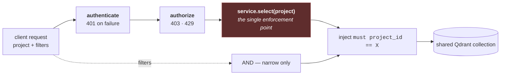
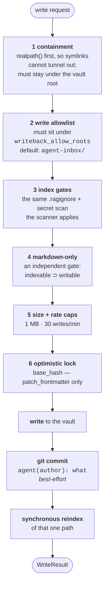

# Security model

VaultRAG sits between an agent and a knowledge base. Four things have to hold:

1. **Secrets never enter the index.** A RAG that memorizes API keys hands them to every
   agent that queries it.
2. **A tenant can never see another tenant's notes.** Enforced server-side, always.
3. **An agent can never write outside its sandbox** — or corrupt a note it didn't read.
4. **Retrieved vault text is data, never instructions.**

Design source: `../Rag/reference/reference-security-model.md`.

---

## Threat model

| Threat | Mitigation | Where |
|---|---|---|
| A `.env` in the vault gets indexed and returned to an agent | Non-overridable filename deny list + content scan, applied at scan **and** parse time | `indexer/secret_guard.py` |
| A note pastes a live AWS key | Two-tier content scan; the whole file is withheld | `secret_guard.scan_for_secrets` |
| A client widens its scope with a crafted filter | `project_id` injected server-side; client filters only AND | `service.select()` |
| A leaked API key reads everything | Per-project, per-level scopes; per-key rate limits | `auth.py`, `api/deps.py` |
| Keys readable from the database | argon2 hashes only; never a plaintext secret | `auth.py` |
| An agent writes outside its allowlist, or escapes via symlink | realpath containment + allowlisted roots | `writeback/writer.py` |
| A looping agent floods the vault | Size cap + sliding-window rate cap | `writeback/writer.py` |
| An agent silently clobbers a concurrent edit | `base_hash` optimistic lock → 409 with live content | `writeback/writer.py` |
| Prompt injection via note content | Snippets are returned as data; VaultRAG never interprets them | design principle #4 |
| The metrics endpoint leaks vault content | It carries no vault content; keyless door is network-scoped only | `docker-compose.yml` |

---

## The secret guard

**Two independent gates**, both enforced *in code*. Unlike `.ragignore`, they cannot be
widened away — `.ragignore` can only ever narrow indexing **further**.

They run at the **scan boundary** and again at **parse time**, so live-watch and write-back
can never sneak a file in that a full `reindex` would withhold.

### Gate 1 — filename deny list

Matched case-insensitively against the POSIX basename. **This set may only ever grow.**

```
.env  .env.*  *.env
id_rsa*  id_dsa*  id_ecdsa*  id_ed25519*
*.pem  *.key  *.ppk  *.p12  *.pfx  *.pkcs12  *.keystore  *.jks  *.kdbx
*credentials*  *secret*
.npmrc  .pypirc  .netrc  .htpasswd  *.pgpass
```

### Gate 2 — content scan

**Precision over recall**, deliberately, so ordinary dev notes full of hashes and UUIDs are
not blocked.

**Tier (a) — self-identifying vendor tokens.** A fixed prefix plus a body of the right
shape. Safe to flag on sight; nothing else in a dev note produces these by accident.

| Rule | Matches |
|---|---|
| `private-key-block` | `-----BEGIN … PRIVATE KEY-----` |
| `aws-access-key-id` | `AKIA`/`ASIA`/`AGPA`/… + 16 chars |
| `github-token` | `ghp_` / `gho_` / `ghu_` / `ghs_` / `ghr_` + 36–255 chars |
| `github-fine-grained-pat` | `github_pat_` + 60+ |
| `slack-token` | `xoxb-`/`xoxa-`/`xoxp-`/… |
| `google-api-key` | `AIza` + 35 |
| `stripe-secret-key` | `sk_live_` / `rk_live_` |
| `openai-key` | `sk-…T3BlbkFJ…` |
| `jwt` | `eyJ….eyJ….…` |

**Tier (b) — keyword-anchored high-entropy assignment.** `api_key = "<random>"` only counts
when the name is secret-ish **and** the value clears a Shannon entropy floor of
**3.2 bits/char**. That is what keeps 40-char git SHAs, UUIDs and base64 diagram blobs from
tripping it. Known placeholders (`your_api_key_here`, `changeme`, `xxxxxxxxxxxx`) are
ignored even when they clear the floor.

Anchored key names: `api_key`, `secret_key`, `secret`, `token`, `passwd`, `password`,
`access_key`, `private_key`, `client_secret`, `auth_token`.

> **A regex detail that was a real bug.** The opening boundary is `(?<![A-Za-z0-9])`, not
> `\b`. `_` is a word character, so a leading `\b` does **not** match inside
> `AWS_SECRET_ACCESS_KEY`, `GITHUB_TOKEN` or `DB_PASSWORD` — i.e. it missed the single most
> common way a real credential is written, while catching the bare `password=` form nobody
> pastes. Underscore and hyphen must read as boundaries; letters and digits must not.

### Two properties worth stating explicitly

**The guard never returns or logs the secret itself** — only the *name* of the rule that
matched. Callers log the path and the rule, never the value.

**Redaction is block-level, not line-level.** A PEM private key's *body* lines do not
self-identify — only the `-----BEGIN…` header matches a rule — so scanning line-by-line
would strip the header and leave the key body searchable. Quarantining the whole block
closes that gap.

### Testing it

A planted fake secret must never be indexed, and there is a test that asserts exactly that.
If you extend the deny list, extend the test.

---

## Tenancy



**Rules that hold everywhere:**

- The `project_id` filter is **injected server-side** from the key's scope. There is no code
  path where a client widens scope.
- The filter goes **inside both prefetch branches** (dense and sparse), not into a
  post-filter — neither retriever can return points the other's filter would have excluded.
- `SearchFiltersParam` has **no `project` field** and sets `extra="forbid"`, so a misspelled
  filter key fails loudly instead of silently not filtering.
- One class serves both the MCP tool schema and the REST body, so a filter cannot narrow
  differently over HTTP than over stdio. A tenancy-adjacent divergence is prevented by
  having one class, not by testing two.

### 403 vs 404 — the honest answer

A key with no entry for project `X` cannot, from the scopes map alone, distinguish "X exists,
you can't see it" from "X doesn't exist".

The scope check consults the **served set** first:

| Case | Response |
|---|---|
| Real project, key has no scope for it | **403** `insufficient-scope` |
| Project does not exist at all | **404** `unknown-project` |

This is the more honest of the two defensible answers, and it is identical to what MCP
already answers for the same typo under a **strictly weaker** trust model — so it leaks
nothing to a caller who is by definition more trusted.

Verified by mutation: neutering that branch killed exactly the three tests written for it,
and nothing else.

### `list_projects` asymmetry, on purpose

| Transport | Filtered? | Why |
|---|---|---|
| MCP | **No** | Stdio has no keys. It inherits local-user trust for everything, always. |
| REST | **Yes**, to the key's scopes | The first transport with a narrower caller. Listing every served project to an unscoped key would leak the existence and writability of tenants it cannot reach. |

The MCP/REST parity test therefore compares against an **admin-everywhere** key — which is
the honest scope of the parity claim, once REST can legitimately answer *less* than MCP for
the same call.

### Verified adversarially

- A decoy project was indexed into the **same collection** with byte-identical note content
  under `DECOY-` prefixed paths — every decoy chunk a perfect-duplicate competitor. The
  72-case eval returned **metrics identical to the digit** with zero decoy paths in any
  ranked list; a 12-query probe showed **zero cross-contamination in both directions**, and
  neither tenant over-filtered to empty.
- Repeated at **100 000** foreign-tenant points in one collection: a `dr-vault` search
  returned only `dr-vault` documents.

---

## API keys

Keys exist because HTTP is the first transport with a caller narrower than "whoever can run
this binary". MCP over stdio has no keys and needs none.

### Format: `id.secret`

Not one opaque token, and the reason is structural. Argon2 is deliberately slow — that is
what makes it a real password hash rather than a fast digest an attacker can brute-force
offline. Authenticating by re-hashing the presented secret against **every** stored key
therefore does not scale past a handful of rows.

Splitting into a public, non-secret `id` (an indexed lookup) and a secret half (the only
thing argon2 ever sees) gives the O(1) check the design asks for: one primary-key read, then
one hash verification.

### Scopes

`read` < `write` < `admin`, **per project**, each level implying the ones before it.

```bash
vaultrag key add --name ci-bot --scope design:read --scope work:write --rate-limit 120
```

A level, not a set, so `write` cannot exist without `read` — the combination nobody wants and
everybody eventually types.

### Rate limits

Per-key **token bucket**, default 60 requests/minute, `0` disables.

A fixed window lets a key burst its whole quota at the window boundary and then again
immediately after; a token bucket smooths that into a genuine sustained rate.

Buckets live in process memory, keyed by key id, and do not survive a restart. That is a
feature, not a gap, on a single-box deployment where a restart is already a discontinuity in
everything else being measured.

### Lifecycle

| Operation | Behaviour |
|---|---|
| `key add` | Prints the key **once**. Nothing holds it again. |
| Lost key | **No recovery path**, like any password. Revoke and mint a new one. |
| `key list` | Shows id, name, scopes. Never the key, never the hash. |
| `key revoke` | Takes effect on that key's **very next request** — no restart, no cache to invalidate. |
| Empty `api_keys` table at `serve` startup | One admin-everywhere key is minted and printed, so there is always a way in. |

> **The bootstrap key is fragile under container recreation.** It is printed once, to that
> container's log. If you recreate the container before saving it, the key still exists but
> its secret is gone. Recovery is `vaultrag key add` (and revoke the orphan id).

### What is stored

argon2 hash, key id, name, scopes, rate limit, timestamps. **No plaintext secret anywhere**
— verified live with `strings` over `state/vaultrag.db`.

Verified by mutation: neutering the `verify_secret` call site (accept any secret) killed
both the wrong-secret test and the no-plaintext-in-store test; neutering the rate-limit
branch killed all three rate-limit tests.

---

## Write-back safety

Every accepted write runs the same gauntlet, **in this order**, so a write can never land
what the read side would refuse to serve.



**Gate 4 is stated independently on purpose.** *Indexable* is a strictly wider set than
*writable*: the scanner learned to read PDFs and images, which must not become targets for a
tool that writes UTF-8 text.

**Gate 3 means a note whose content is key material is refused** — unwritable **and** never
indexed, since `ingest_path` re-gates it too.

**Gate 6 applies only to `patch_frontmatter`**, because it mutates in place.
`append_section` is additive (it inserts at a section's end), so it takes no lock and two
concurrent appends both survive.

### Ordering guarantees

- **The write is durable in the vault (and git) before indexing is attempted.** If Qdrant is
  down, the note is still safely written and the result says `indexed: false` with a
  warning. There is no path where a write reports success and isn't on disk.
- **Git is best-effort.** A non-git vault still gets the write and the index; the commit is
  just skipped. The vault, not git, is the source of truth.
- **The critical section is serialized under one lock.** FastMCP runs tools in worker
  threads, so accept→write→commit→ingest is one atomic region — which is also what makes the
  sliding-window rate cap correct. Write-back is not a hot path, so serializing it is the
  simple, safe choice.

### Provenance

Every agent-written note carries frontmatter identifying it: `author`, `via: vaultrag`,
`created`. Commits are `agent(<author>): <what>`, so agent writes are distinguishable from a
human's in `git log`.

---

## Prompt injection

**Retrieved vault text is untrusted data.**

In `snippets` mode — the default and the only served mode — VaultRAG **never executes or
interprets** what it returns. It ranks bytes and hands them over with a citation. There is
no template into which retrieved text is interpolated, no tool call derived from it, and no
LLM in the read path at all.

That is not merely a policy; it is a consequence of [returning snippets rather than
answers](design-decisions.md#snippets-not-answers). The design's opt-in `answer` mode would
wrap sources in delimited blocks — and it is deliberately unbuilt.

**What this does not protect against:** the *consuming* agent reading a snippet containing
instructions and acting on it. That is the client's trust boundary, not VaultRAG's. Treat
every snippet as content from whoever can write to the vault.

---

## Network posture

| Surface | Default bind | Published by compose |
|---|---|---|
| REST `/v1` + `/metrics` | `127.0.0.1:8000` | `127.0.0.1:8000` |
| Qdrant | — | `127.0.0.1:6333`, `127.0.0.1:6334` |
| Keyless metrics exporter | `127.0.0.1:9464` (`0.0.0.0` in-container) | **never published** |
| Grafana / Prometheus / Alertmanager | — | `127.0.0.1` only |

**Remote access is Tailscale or WireGuard, not an open port.** Binding `0.0.0.0` is a
decision that must be typed out.

Inside a container the loopback default would make the port unreachable even from the
compose network, so the compose file widens the bind **inside** the container and narrows it
again with a loopback-only publish. Both halves of that decision are visible in one file
rather than one being an invisible image default.

**Grafana runs with anonymous admin access**, deliberately: it is loopback-published and
inside the same trust boundary as the vault it observes. A login prompt on a single-box
dashboard buys nothing an operator wants to pay for.

**Qdrant has no auth in front of it** by default, which is exactly why it is loopback-only.

---

## Logging

- Structured JSON via structlog, **stderr only** (stdout is the MCP JSON-RPC channel).
- **Raw query text never enters the log stream or the metrics** — under either
  `query_log_text` setting. A test pins that.
- **Secrets are never logged at any level.** The guard returns rule *names*, never values.
- The query log's `query_text` column is a *database* column, not a log line, and it is the
  one place raw query text is retained — opt-out via `VAULTRAG_QUERY_LOG_TEXT=false` for
  shared multi-tenant deployments.

---

## Deployment checklist

```
□  .ragignore present in the vault root, reviewed
□  `vaultrag key add` used — the printed bootstrap key saved or revoked
□  Scopes are least-privilege (read-only keys for read-only consumers)
□  Rate limits set for any key a machine holds
□  API bound to loopback; remote access over Tailscale/WireGuard
□  VAULTRAG_UID/GID own the vault (write-back permissions)
□  writeback_allow_roots reviewed — default is agent-inbox/ only
□  Vault has a git remote (that remote IS the backup)
□  query_log backed up if you rely on the mining loop (nothing rebuilds it)
□  VAULTRAG_QUERY_LOG_TEXT=false if the deployment is shared/multi-tenant
□  Alertmanager pointed at a topic you own
```

---

## Related reading

- [Architecture §tenancy](architecture.md#7-multi-tenancy) — the enforcement point in context
- [REST API §authentication](rest-api.md#authentication) — status codes and scopes
- [Indexing §the gates](indexing.md#2-the-gates) — where the secret guard runs
- [Configuration §write-back](configuration.md#write-back) — the tunable half of these guardrails
